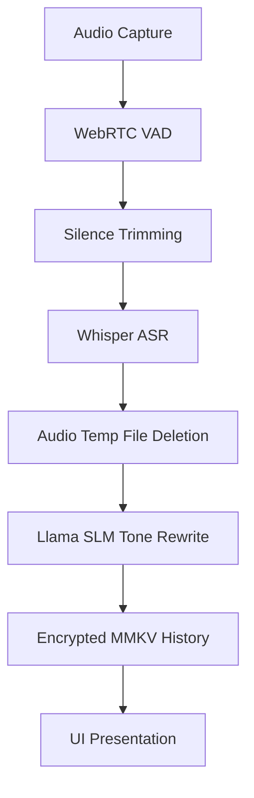

# VoiceNote


**VoiceNote** is a fully offline, privacy-first mobile voice-memo app that transcribes speech to text on-device (English, Hindi, Hinglish) and rewrites it into chosen tones (Professional, Casual).

## Key Features

- **On-Device ASR:** Whisper-powered transcription supporting English (en), Hindi (hi), and Hinglish (code-switched).
- **On-Device SLM Tone Rewriting:** Llama GGUF models rewrite raw transcripts into Professional or Casual tones with named entity preservation.
- **WebRTC Voice Activity Detection:** Silence auto-stop and trimming powered by WebRTC VAD.
- **Ephemeral Audio Handling:** Strict deletion of temporary audio files immediately post-ASR.
- **Encrypted Offline Storage:** MMKV + OS Keychain AES-256 with 50-note FIFO cap and resilient in-memory fallback.
- **Real-Time Waveform & Instant Tone Re-rewriting:** Smooth visual feedback and blazing fast rewrites.
- **System Dark/Light Theme:** Native adaptation to system appearance.

## Architecture & Processing Pipeline



## Project Structure

```text
VoiceNote/
├── docs/                 # Documentation (PRD, Technical Guides, etc.)
├── macos/                # macOS native project files
├── src/
│   ├── audio/            # Audio capture & VAD utilities
│   ├── components/       # Reusable React UI components
│   ├── ml/               # Whisper and Llama inference wrappers
│   ├── native/           # TurboModules, Nitro modules, JSI bindings
│   ├── navigation/       # React Navigation setup
│   ├── pipeline/         # Orchestration of the ASR -> SLM flow
│   ├── screens/          # Main app screens
│   ├── services/         # Model downloader & external integrations
│   ├── state/            # Zustand stores & MMKV storage implementations
│   └── utils/            # Helpers, formatters, logger
└── package.json
```

## Prerequisites & Setup

- **Node.js**: >= 18
- **macOS**: Required for desktop/iOS development.
- **Xcode & CocoaPods**: Required for Apple targets.
- **Android Studio**: Required for Android targets.

To install dependencies:

```bash
npm install
```

## Running the App

- **macOS Desktop**:
  ```bash
  npm run macos
  ```
- **iOS**:
  ```bash
  npm run ios
  ```
- **Android**:
  ```bash
  npm run android
  ```

## Verification & Quality Checks

Ensure there are no regressions by running the full validation suite:

- **Tests** (all 30 test suites, 140 tests):
  ```bash
  npm test
  ```
- **Type Checking**:
  ```bash
  npm run typecheck
  ```
- **Privacy Audit**:
  The privacy audit script checks the codebase for disallowed modules (e.g., `fetch`, `AsyncStorage`, analytics SDKs) to ensure strict adherence to our privacy guidelines.
  ```bash
  npm run audit:privacy
  ```

## Engineering & Privacy Constraints (Non-Negotiables)

1. **Zero Cloud Inference**: 100% offline. No API calls for ASR or SLM.
2. **Zero Telemetry / Analytics**: No crash reporters or tracking SDKs.
3. **Audio Ephemerality**: Temporary audio files must be deleted immediately after transcription, even on failure.
4. **Off-Main-Thread Execution**: All heavy ML inference must run off the JS main thread (via Nitro modules or JSI isolates).

For deeper context, see [`docs/PRD.md`](docs/PRD.md) and [`docs/TECHNICAL_GUIDE.md`](docs/TECHNICAL_GUIDE.md).
