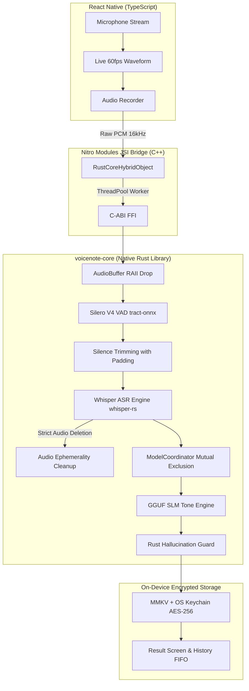

# VoiceNote


**VoiceNote** is a fully offline, privacy-first mobile voice-memo app that transcribes speech to text on-device (English, Hindi, Hinglish) and rewrites it into chosen tones (Professional, Casual).

Powered by a unified, memory-safe native Rust engine (**`voicenote-core`**) interfaced with React Native via Nitro Modules JSI, VoiceNote delivers desktop- and workstation-grade ML performance directly on mobile devices without any cloud dependencies.

## Key Features

- **On-Device Rust Core (`voicenote-core`):** Unified native static library delivering audio processing, VAD, ASR, SLM, and cryptographic verification on macOS, iOS, and Android.
- **Asynchronous JSI ThreadPool:** Nitro Modules 0.18 C++ bridge (`RustCoreHybridObject`) offloads heavy inference to background threads, guaranteeing 60 fps UI responsiveness without freezing animations or waveforms.
- **On-Device Whisper ASR:** Local speech recognition via `whisper-rs` (whisper.cpp) with Apple Silicon Metal acceleration, compile-time CoreML validation on iOS, and Hinglish script steering.
- **Long-Audio Silence Segmentation:** Recordings longer than 27s are segmented at natural silence boundaries to prevent Whisper's 30s window cutoff.
- **5-Minute Live Rolling Whisper Engine:** Continuous capture up to 300s with silence-boundary chunking (20–25s slices), FIFO background Whisper worker, and sequential semantic paragraph SLM rewriting (150–200 words).
- **Standalone Packaging Pipelines (< 80 MB):** Universal macOS `.dmg` installer (`lipo` universal binary + inside-out codesigning) and standalone signed Android `.apk` (React Native 0.76 Gradle/NDK scaffolding + JNI bridge) enforcing an 80 MB ceiling with zero bundled model weights.
- **On-Device SLM Tone Rewriting:** On-device GGUF SLM engine rewriting raw transcripts into Professional or Casual tones.
- **Hallucination Guard in Rust:** Entity preservation regex engine checking numbers, dates, times, currencies, and proper nouns with [0.35×, 2.5×] length bounds.
- **Memory Protection & Mutual Exclusion:** `ModelCoordinator` keeps peak RAM strictly **< 500 MB** by guaranteeing Whisper and LLaMA are never concurrently resident, with a 60-second idle auto-unload timer.
- **Silero V4 Voice Activity Detection:** Real-time ONNX VAD running via `tract-onnx` on-device with debounced state machine auto-stop (1000–2000 ms) and `resetVad()` LSTM state clearing.
- **Audio Ephemerality (Drop RAII):** Temporary audio files written to disk are strictly deleted upon completion, cancellation, or thread abort.
- **Streaming SHA-256 Verifier:** Zero-copy streaming file hash validation via `ring = "0.17"` verifying multi-hundred MB model weights directly from disk.
- **Encrypted Offline Storage:** MMKV + OS Keychain AES-256 with 50-note FIFO cap and resilient in-memory fallback.
- **Real-Time Waveform & Theme Adaptation:** 60 fps visual audio feedback adapting seamlessly to system dark and light modes.

## Architecture & Processing Pipeline



## Project Structure

```text
VoiceNote/
├── docs/                 # Product specifications, technical deep-dive, and task plans
├── rust/                 # Unified native Rust core
│   ├── Cargo.toml        # Workspace manifest
│   └── voicenote-core/   # Core crate (AudioBuffer, VAD, ASR, SLM, Crypto)
├── scripts/              # Cross-compilation scripts (build-macos, build-ios, build-android)
├── macos/                # macOS native project files & static lib destination
├── ios/                  # iOS XCFramework destination & native project files
├── android/              # Android JNI libraries destination & native project files
├── src/
│   ├── audio/            # Audio capture & VAD utilities
│   ├── components/       # Reusable React UI components & Waveform
│   ├── ml/               # Whisper & Llama TypeScript orchestrator and types
│   ├── native/           # Nitro Modules JSI bridge & RustCore hybrid object
│   ├── navigation/       # React Navigation single native stack
│   ├── pipeline/         # End-to-end pipeline orchestrator
│   ├── screens/          # Home, Result, History, Models, Settings, Privacy
│   ├── services/         # Model downloader & encrypted history service
│   ├── state/            # Zustand stores & MMKV storage implementations
│   └── utils/            # Helpers, formatters, and logger
└── package.json
```

## Prerequisites & Setup

- **Node.js**: >= 18
- **Rust**: 1.82+ (2021 edition) with `rustup`
- **macOS**: Required for desktop / iOS development (Apple Silicon recommended)
- **Xcode & CocoaPods**: Required for Apple targets
- **Android Studio & NDK**: Required for Android targets (`cargo-ndk` optional for local builds)

To install JavaScript dependencies:

```bash
npm install
```

To build the native Rust static library:

```bash
# macOS
bash scripts/build-macos.sh

# iOS XCFramework
bash scripts/build-ios.sh

# Android (when cargo-ndk is installed)
bash scripts/build-android.sh
```

## Running the App in Development

- **macOS Desktop**:
  ```bash
  npm run macos
  ```
- **iOS**:
  ```bash
  npm run ios
  ```
- **Android**:
  ```bash
  npm run android
  ```

## Standalone Production Packaging (< 80 MB)

VoiceNote provides headless, automated release packaging pipelines to compile, bundle, and distribute standalone installers without an active Metro server:

- **macOS Universal DMG** (Universal Apple Silicon & Intel `arm64` + `x86_64`):
  ```bash
  npm run build:macos:dmg
  ```
  Generates `dist/VoiceNote-1.0.0.dmg`. Includes inside-out ad-hoc codesigning and drag-and-drop `/Applications` staging.

- **Android Standalone Release APK** (Targeting `arm64-v8a` API 29+):
  ```bash
  npm run build:android:release
  ```
  Generates `dist/VoiceNote-1.0.0-arm64-v8a.apk` with bundled offline JS, compiled JNI, and dynamic signature verification.

- **Generate Developer Keystore**:
  ```bash
  npm run generate:android:keystore
  ```

- **Build All Release Artifacts**:
  ```bash
  npm run build:all
  ```

For detailed toolchain setup, Gatekeeper bypass (`xattr -cr`), and Android sideloading instructions, see [`docs/PACKAGING.md`](docs/PACKAGING.md).

## Verification & Quality Checks

VoiceNote enforces a strict zero-regression testing protocol:

- **Rust Core Test Suite** (68 unit/integration tests across 10 test suites):
  ```bash
  cargo test --manifest-path rust/Cargo.toml
  ```
- **TypeScript & Jest Test Suite** (280 tests across 50 test suites):
  ```bash
  npm test
  ```
- **Standalone Packaging Sanity Suite** (33 tests):
  ```bash
  npm test tests/native/packagingSanity.test.ts
  ```
- **TypeScript Strict Type Checking** (0 errors):
  ```bash
  npm run typecheck
  ```
- **Zero-Cloud Privacy Audit**:
  Verifies that zero unauthorized network APIs (`fetch`, `axios`, `XMLHttpRequest`), zero analytics SDKs, and zero unencrypted storage modules are present:
  ```bash
  npm run audit:privacy
  ```

## Engineering & Privacy Constraints (Non-Negotiables)

1. **Zero Cloud Inference**: 100% offline. No audio, transcript, or text ever leaves the physical device.
2. **Zero Telemetry / Analytics**: No crash reporters, performance trackers, or analytics SDKs.
3. **Strict Audio Ephemerality**: Temporary audio files are managed via Rust RAII `Drop` and deleted immediately after transcription, even on failure.
4. **Memory Budget**: Peak RAM remains strictly **< 500 MB** enforced via `ModelCoordinator` mutual exclusion.
5. **On-Demand Model Provisioning**: Installers remain strictly **< 80 MB**; model weights are never bundled into application assets and must be downloaded post-install with explicit user consent.
6. **Off-Main-Thread Execution**: All heavy ML inference runs asynchronously on Nitro's background `ThreadPool` off the React Native UI thread.

For deeper context, see [`docs/PRD.md`](docs/PRD.md), [`docs/PACKAGING.md`](docs/PACKAGING.md), [`docs/TECHNICAL_GUIDE.md`](docs/TECHNICAL_GUIDE.md), [`docs/designs/`](docs/designs/), and [`rust/README.md`](rust/README.md).
