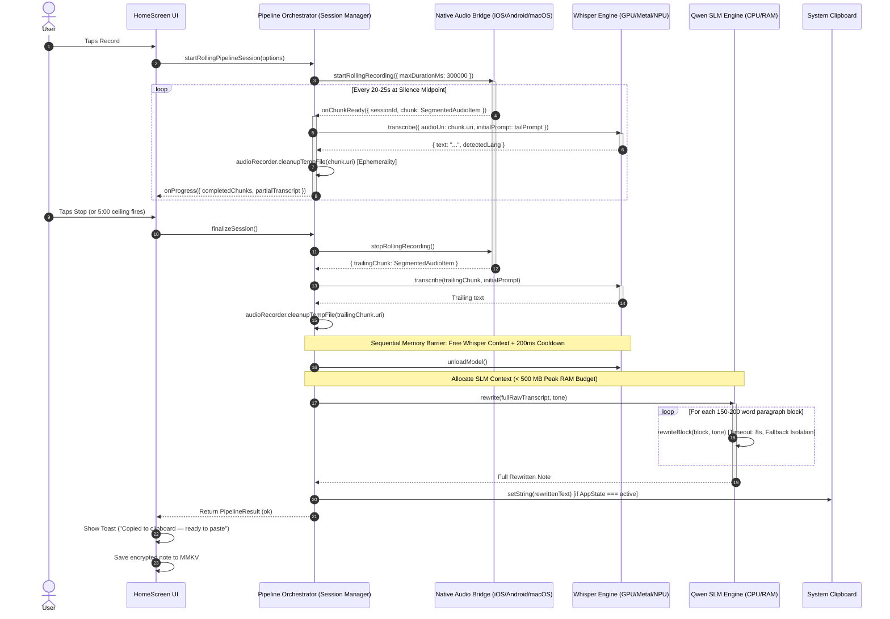

# Long-Audio Capture & Transcription (5-Minute Continuous Pipeline)

*   **Author:** Sitesh Jha
*   **Status:** Approved
*   **Date:** 2026-11-08

--------------------------------------------------------------------------------

## Overview

VoiceNote converts spoken speech into text and rewrites it into a selected tone (Professional or Casual) completely locally and offline. Currently, audio capture terminates prematurely after 13–15 seconds during natural conversational pauses, dropping subsequent speech and destroying recorded data.

This design document specifies the architecture for supporting continuous speech capture and transcription for up to a strict 5-minute (300-second) upper bound across **bare iOS and bare Android (production targets)**, with **macOS desktop serving as development and testing harness**. By introducing a **Native Live Rolling Whisper Engine**, the app slices audio into 20–25 second silence-bounded chunks and transcribes them in a background worker during recording. Upon recording completion, the final trailing chunk finishes in 2–3 seconds, the merged transcript is rewritten by an on-device Small Language Model (SLM) using sequential paragraph chunking, and the output is copied automatically to the system clipboard—guaranteeing 100% offline privacy, immediate audio ephemerality, and strict adherence to the < 500 MB peak RAM ceiling.

---

## The Problem

Investigation of the VoiceNote codebase identified four compounding defects causing premature recording termination and trailing data loss:

1. **Premature Apple Speech Framework Deletion (`AppDelegate.mm`)**:
   In `src/native/whisperNative.ts`, transcription delegates to `VoiceNoteNativeAudio.transcribeAudio` whenever `nativeAudio.isNativeAvailable` is true. On macOS/iOS, this invokes Apple's `SFSpeechRecognizer` with `SFSpeechURLRecognitionRequest`. Because Apple's engine is designed for short voice commands, the first conversational pause (typically at 12–15s) triggers `isFinal = YES`. In `AppDelegate.mm` (line 419), receiving `isFinal` resolves the promise and unlinks the audio file (`removeItemAtPath:`). The remaining minutes of recorded audio are permanently wiped from disk before ever being processed.

2. **Filesystem Shim Blindness in React Native (`src/shims/fs.js`)**:
   `src/ml/asr/index.ts` contains segmentation logic (`computeSegmentBoundaries` for audio > 27s) that depends on `fs.readFileSync(uri)` and `extractPcmFromWav`. However, in the React Native runtime, `src/shims/fs.js` serves an in-memory `Map`. When native recording writes audio to physical disk (`NSTemporaryDirectory`), `memFiles.get(uri)` returns empty. As a result, `pcmAvailable` is false, `audioDurationMs` defaults to a dummy ~30ms, and the JS-side segmentation logic is skipped completely.

3. **Whisper 30-Second Attention Window & Fixed Timeout Caps**:
   Whisper models (`whisper.cpp` / `whisper-rs`) strictly process 80-channel / 3000-frame log-mel spectrograms representing at most 30.0 seconds of audio. Feeding an unchunked audio file longer than 30s triggers repetitive hallucinations, buffer overflow, or hard truncation. Furthermore, `whisperNative.ts` hardcodes `ASR_TIMEOUT_MS = 30_000`, causing longer inference tasks to abort mid-stream with `ASR_TIMEOUT`.

4. **Post-Stop Processing Latency & SLM Scaling Bottlenecks**:
   Transcribing 5 minutes (300s) of audio post-stop in a single monolithic batch forces the user to wait 30–75 seconds behind a blocking spinner. Furthermore, 5 minutes of speech yields 750–1,000 words (~1,500 tokens). Passing 1,500 tokens in a single prompt to an on-device 0.5B/1B SLM exceeds the 10-second SLM safety timeout (`02-on-device-ml-safety.md`) and risks severe context truncation or hallucination.

---

## Goals

* **5-Minute Continuous Recording**: Allow uninterrupted voice recording up to a strict 300-second ceiling across bare iOS, bare Android, and macOS desktop.
* **Live Rolling Chunk Transcription**: Partition audio into silence-bounded rolling segments (20–25s) during recording, transcribing chunks 1..N-1 in a background worker while speech continues.
* **Bounded Post-Stop Latency (10–13s Total)**: The final trailing chunk finishes transcription within 2–3 seconds of stopping recording; sequential paragraph SLM rewriting finishes in 6–8 seconds; total wait is transparently tracked with progress indicators.
* **Deterministic Chunk Continuity**: Prevent word clipping or repetition across chunk boundaries by slicing at silence midpoints (>= 350ms below -36 dBFS) and conditioning chunk $N$ with the trailing 40 characters of chunk $N-1$ via Whisper's `initial_prompt`.
* **Sequential Paragraph SLM Rewriting**: Segment the 5-minute transcript into 150–200 word semantic paragraphs, rewriting each block within an 8s timeout with fallback isolation and entity preservation.
* **Automatic System Clipboard Copy**: Copy the final rewritten text (or sanitized raw transcript fallback) to the system clipboard upon pipeline completion, displaying a non-blocking toast. Guard against background clipboard failure on mobile.
* **Predictable Ceiling UI**: Display live timer countdown (`MM:SS / 05:00`), trigger an amber warning with haptic feedback at 4:30 (30s remaining), render a countdown banner at 4:50, and cleanly auto-stop at 5:00.
* **Strict Non-Negotiable Invariants**: Zero cloud inference, zero telemetry, immediate audio chunk deletion post-ASR, startup sanitation pass for aborted chunks, and peak RAM strictly under 500 MB via sequential model unmapping with a 200ms deallocation cooldown.

---

## Non-Goals

* Continuous 24/7 ambient recording or background audio logging beyond the 5-minute limit.
* Multi-speaker diarization, speaker separation, or acoustic voiceprint identification.
* Real-time word-by-word streaming transcript rendering if it induces UI thread frame drops.
* Cloud API inference, hybrid cloud fallbacks, or remote telemetry transmission.

---

## Critical User Journeys (CUJs)

### CUJ 1: Extended Dictation with In-Place Auto-Copy
* **Given**: VoiceNote is open on iOS, Android, or macOS with baseline Whisper and SLM models provisioned and `autoCopyToClipboard` enabled.
* **When**: The user taps Record, speaks continuously for 3 minutes across multiple paragraphs, and taps Stop.
* **Then**:
  - Chunks 1 through 7 are transcribed in the background while the user speaks.
  - Upon tapping Stop, trailing chunk 8 finishes in < 2.5 seconds.
  - Whisper context is unmapped from RAM (200ms deallocation cooldown).
  - The merged transcript is rewritten paragraph-by-paragraph by the on-device SLM in ~6 seconds with progressive UI feedback.
  - The final rewritten note is copied directly to the system clipboard, an in-tree toast announces *"Copied to clipboard — ready to paste"*, and the note is encrypted and saved to history.

### CUJ 2: Reaching the 5-Minute Ceiling
* **Given**: The user starts recording an extensive meeting summary or train-of-thought note.
* **When**: The recording duration reaches 4:30 (270s).
* **Then**:
  - The duration timer turns amber and triggers a warning haptic (`haptics.trigger('warning')`).
  - At 4:50, a non-blocking banner notifies the user: *"VoiceNote limits recordings to 5 minutes. Auto-stopping in 10s..."*.
  - At exactly 5:00 (300s), the recorder automatically executes the stop flow, seals the final chunk, finalizes transcription and tone rewriting, and auto-copies the output.

### CUJ 3: Manual Cancellation Mid-Recording & Crash Recovery
* **Given**: A recording is in progress at 2 minutes with several chunks already transcribed in the background queue.
* **When**: The user taps the "Cancel" button (or the app process terminates abruptly).
* **Then**:
  - Recording halts immediately.
  - Active Whisper inference is aborted.
  - All temporary chunk audio files on disk are unlinked via `cleanupTempFile`.
  - On next app startup, a sanitation pass sweeps the cache directory and unlinks any stranded `voicenote_chunk_*.wav` files.
  - The UI resets to `idle` without altering the system clipboard or saving history records.

---

## Technical Plan (Architecture)

### 1. Architectural Overview & Session Lifecycle

The live rolling architecture uses a session-based producer-consumer model coordinated in `src/pipeline/orchestrator.ts`.

---

### 2. Native Live Rolling Audio Capture Layer

#### Slicing Mechanism
* The native recording engine records 16 kHz 16-bit linear PCM audio into a rolling buffer.
* **Silence Boundary Evaluation (20.0s – 25.0s Window)**:
  - Starting at 20.0s, the background audio monitor evaluates RMS energy every 50ms.
  - When RMS stays below **-36 dBFS (normalized linear amplitude < 0.0158)** for at least **350 ms**, a cut point is triggered at the **midpoint of the silence gap**.
  - If no qualifying pause occurs before **25.0s**, the engine executes a hard boundary cut.
* **Zero Acoustic Pre-Roll**:
  - Slicing at the silence midpoint guarantees natural silence flanks on both sides of the seam, eliminating the acoustic duplication hazard that caused word repetition.
* **File Slicing & Dispatch**:
  - The slice is saved as an ephemeral WAV file in the platform cache directory: `voicenote_chunk_<sessionId>_<chunkIndex>.wav`.
  - Dispatches `onChunkReady` event containing `{ sessionId, chunk: SegmentedAudioItem }` to the bridge.

#### Platform-Specific Implementations
* **iOS Bare (`ios/VoiceNote/`)**:
  - Primary production target. `AVAudioEngine` input node tap writes 16 kHz PCM frames to rolling cache WAV files off the main UI thread.
* **Android Bare (`android/app/src/main/java/.../`)**:
  - Primary production target. Background `AudioRecord` thread writes rolling PCM chunk files to `context.getCacheDir()`.
* **macOS Desktop (`macos/voicenote-macOS/AppDelegate.mm`)**:
  - Development and testing harness. Remove `SFSpeechRecognizer` delegation; use `AVAudioRecorder` writing rolling cache WAV files.

---

### 3. Background Whisper ASR Worker & Orchestration

* **Session Manager in `src/pipeline/orchestrator.ts`**:
  - Implements `startRollingPipelineSession()` returning `{ pushChunk, finalizeSession, cancelSession }`.
  - Maintains a FIFO queue capped at max 1 pending chunk.
  - If inference duration exceeds chunk duration ($RTF \ge 1.0$), audio recording continues uninterrupted to disk, while background ASR pauses until stop to prevent thread starvation.
* **Seam Conditioning (`initial_prompt`)**:
  - To prevent word clipping or hallucinated prefixes across chunk boundaries, chunk $N$ ($N \ge 1$) receives the trailing 40 characters of chunk $N-1$'s transcription as its `initialPrompt`:
    $$\text{initialPrompt}_N = \text{tail}(\text{transcript}_{N-1}, 40)$$
* **Audio Ephemerality & Startup Sanitation**:
  - Immediately after transcribing chunk $K$, `audioRecorder.cleanupTempFile(chunk.uri)` unlinks the chunk WAV inside a `finally` block.
  - On app startup, `AudioRecorderService.init()` sweeps the cache directory and unlinks any stranded `voicenote_chunk_*.wav` files.
* **Fault-Tolerant Chunk Error Recovery**:
  - If an intermediate chunk fails (`ASR_TIMEOUT` or `ASR_EMPTY_OUTPUT`), the orchestrator inserts a localized placeholder `[untranscribed audio: 20s–25s]`, logs a warning, and continues transcribing subsequent chunks.

---

### 4. Sequential Paragraph SLM Rewriter

* **Context & Timeout Management**:
  - A 5-minute recording produces ~850 words. A single 1,500-token prompt fed into on-device Qwen 2.5 0.5B takes > 18s on mobile CPU, violating the non-negotiable 10-second timeout (`02-on-device-ml-safety.md`).
* **Semantic Paragraph Slicing Algorithm**:
  1. The merged transcript is parsed into semantic paragraphs targeting **150–200 words per block** using sentence punctuation (`\n\n`, `.`, `?`, `!`).
  2. **Run-On Fallback**: If no terminal punctuation occurs within 180 words, force a split at the nearest clause boundary (comma, semicolon, conjunction) to prevent monolithic prompts.
  3. Each block is dispatched sequentially to `rewrite(block, tone)` with a strict **8-second timeout** per block.
  4. Entity preservation (`validatePreservation`) is evaluated per block. If a block fails or times out, that specific block falls back to its raw transcript while remaining blocks continue rewriting.
  5. The rewritten blocks are assembled with standard paragraph breaks (`\n\n`).

---

### 5. Memory Invariant & Model Coordination (< 500 MB RAM Ceiling)

* **Peak Memory Analysis**:
  - React Native Base & App State: ~45 MB.
  - Audio Capture Buffers (PCM & WAV): ~8 MB.
  - Whisper Base Q5_1 Context: ~148 MB.
  - Qwen 2.5 0.5B Q4_K_M Context: ~380 MB.
* **The Enforcement Strategy**:
  - During recording, Whisper remains loaded in memory to service rolling chunks in real time. Qwen is completely unallocated.
  - Peak recording RAM: $148 + 8 + 45 = \mathbf{201\text{ MB}}$ (Well under 500 MB budget).
  - When recording stops and trailing chunk completes transcription:
    1. Call `await whisperNative.unloadModel()`.
    2. Execute an asynchronous **200ms deallocation cooldown** to allow native GPU command queues (Metal / OpenCL) to release memory.
    3. Allocate Qwen context via `llama.rn` / `rustCore`.
  - Peak rewriting RAM: $380 + 45 = \mathbf{425\text{ MB}}$ (Under 500 MB budget).

---

### 6. User Interface & 5-Minute Auto-Stop State Machine

* **Timer UI & Warning Progression**:
  - The duration label in `HomeScreen.tsx` updates every 100ms: `MM:SS / 05:00`.
  - **4:30 (270s) Warning**:
    - Duration text switches to amber (`#F59E0B`).
    - Haptic warning fires: `haptics.trigger('warning')`.
  - **4:50 (290s) Countdown**:
    - Floating banner displays: *"VoiceNote limit is 5 minutes. Auto-stopping in 10s..."*.
  - **5:00 (300s) Ceiling**:
    - `handleStopRecording()` triggers automatically via interval timer.
    - Status badge updates to: *"Finalizing 5-minute recording..."*.
* **Progressive Feedback**:
  - Below the waveform, a live counter displays completed chunks: *"Transcribed 2m 15s in background..."*.
  - During SLM rewrite, displays: *"Polishing tone (paragraph 2 of 4)..."*.

---

## Detailed Implementation Plan

### 1. File Inventory & Modification Rationale

| File Path | Type | Action | Rationale | Method Signatures / Contracts |
| :--- | :--- | :--- | :--- | :--- |
| `macos/voicenote-macOS/AppDelegate.mm` | Native (Obj-C++) | Modify | Replace premature `SFSpeechRecognizer` file deletion with native rolling chunk recorder (dev harness). | `startRollingRecording()`, `stopRollingRecording()` |
| `ios/VoiceNote/AppDelegate.mm` | Native (Obj-C++) | Modify | Implement iOS native rolling audio recorder using `AVAudioEngine` input tap. | `startRollingRecording()`, `stopRollingRecording()` |
| `android/app/src/main/java/com/voicenote/VoiceNoteNativeAudioModule.kt` | Native (Kotlin) | Modify | Implement Android native rolling audio recorder using background `AudioRecord`. | `startRollingRecording()`, `stopRollingRecording()` |
| `src/native/nativeAudio.ts` | TypeScript | Modify | Expose rolling recording methods and chunk event listeners across JSI bridge. | `startRollingRecording(opts): Promise<boolean>`, `addChunkReadyListener(cb): () => void` |
| `src/native/audioWorker.ts` | TypeScript | Modify | Add rolling chunk generation simulation for Node/Jest environments. | `simulateRollingChunks(count: number, intervalMs: number)` |
| `src/native/rustCore/index.ts` | TypeScript | Modify | Update Jest mock `transcribe()` to simulate `initialPrompt` seam conditioning for unit tests. | `createDefaultMockInstance().transcribe` |
| `src/native/whisperNative.ts` | TypeScript | Modify | Remove Apple Speech bypass; maintain strict inference focus with prompt conditioning. | `transcribe(opts: WhisperInferenceOptions): Promise<WhisperNativeResult>` |
| `src/pipeline/types.ts` | TypeScript | Modify | Extend `SegmentedAudioItem` and `SegmentedAudioInput` with rolling session events. | `ChunkReadyEvent { sessionId: string; chunk: SegmentedAudioItem }` |
| `src/pipeline/orchestrator.ts` | TypeScript | Modify | Implement `startRollingPipelineSession()` managing FIFO queue, unlinking files, and model cooldown. | `startRollingPipelineSession(opts, onProgress): RollingSessionController` |
| `src/audio/recorder.ts` | TypeScript | Modify | Add startup sanitation pass to purge stranded `voicenote_chunk_*.wav` files on initialization. | `init(): Promise<void>`, `cleanupOrphanedChunks(): Promise<void>` |
| `src/audio/useAudioRecorder.ts` | TypeScript | Modify | Expose duration up to 300s, warning flags (`isWarning430`, `isBanner450`, `isCeiling500`), and chunk progress. | `useAudioRecorder(opts): UseAudioRecorderReturn` |
| `src/ml/slm/index.ts` | TypeScript | Modify | Implement `rewriteParagraphs()` and auto-delegate in `rewrite()` for transcripts > 200 words. | `rewriteParagraphs(text, tone, opts): Promise<SlmRewriteResult>` |
| `src/screens/HomeScreen.tsx` | TypeScript (React) | Modify | Update timer display to `MM:SS / 05:00`, amber styling at 4:30, 4:50 banner, and 5:00 auto-stop. | React FC UI Component |
| `tests/audio/recorderRolling.test.ts` | TypeScript (Jest) | Create | Unit test rolling slice rotation, zero-overlap silence boundary detection, and 5-minute ceiling auto-stop. | Automated Jest Test Suite |
| `tests/pipeline/orchestratorRolling.test.ts` | TypeScript (Jest) | Create | Unit test FIFO chunk worker, seam prompt conditioning, localized chunk failure recovery, audio ephemerality, and SLM deallocation sequence. | Automated Jest Test Suite |
| `tests/ml/slmParagraphs.test.ts` | TypeScript (Jest) | Create | Unit test semantic paragraph chunking, 8s per-block timeout enforcement, entity preservation, and fallback isolation. | Automated Jest Test Suite |
| `tests/screens/homeScreen5Min.test.ts` | TypeScript (Jest) | Create | Unit test UI countdown timer, amber styling at 4:30, and automatic stop trigger at 300s. | Automated Jest Test Suite |
| `docs/PRD.md` | Markdown | Modify | Document the 5-minute live rolling architecture, latency targets, and ceiling rules. | Documentation Update |
| `docs/TASKS.md` | Markdown | Modify | Add Phase 8 task breakdown for tracking development and verification. | Task Tracking Update |
| `docs/plans/TASK_PLAN.md` | Markdown | Modify | Maintain unified engineering protocol plan with test verification status. | Task Plan Update |

---

### 2. Step-by-Step Implementation Sequence

#### Phase 1: Native Rolling Audio Capture Engine
1. **Silence-Aware Native Slicing (`AppDelegate.mm` / Native Audio Modules)**:
   - Slicing evaluates silence between 20.0s and 25.0s (RMS < -36 dBFS for >= 350ms).
   - Slice cut point is placed at the silence midpoint. Zero acoustic pre-roll is prepended.
   - Saves slice to `voicenote_chunk_<session>_<idx>.wav` and emits `onChunkReady` event.
2. **Hard 5-Minute Safety Ceiling**:
   - Native timer expires at 300.0s, automatically seals trailing chunk, and dispatches `onCeilingReached`.
3. **Startup Sanitation Pass**:
   - `AudioRecorderService.init()` sweeps the cache directory on startup and unlinks any stranded `voicenote_chunk_*.wav` files.

#### Phase 2: Background FIFO Whisper Worker & Session Orchestration
4. **Session Controller (`orchestrator.ts`)**:
   - Implement `startRollingPipelineSession(options, onProgress)`.
   - Ingests `onChunkReady` into a FIFO queue (depth cap: 1).
   - Condition chunk N with the trailing 40 characters of chunk N-1 text as `initialPrompt`.
   - Enforce immediate unlinking: call `audioRecorder.cleanupTempFile(chunk.uri)` inside `finally`.
5. **Stop & Finalization Handshake**:
   - When manual stop or 5:00 ceiling occurs, seal trailing chunk.
   - Await in-flight chunk resolution.
   - Merge chunk transcripts in deterministic index order with seam word deduplication.
   - Invoke `await whisperNative.unloadModel()`, followed by a 200ms deallocation cooldown.

#### Phase 3: Semantic Paragraph SLM Tone Rewriter
6. **Paragraph Slicing & Isolated Execution (`src/ml/slm/index.ts`)**:
   - Divide merged transcript into 150–200 word semantic blocks based on sentence boundaries (`\n\n`, `.`, `?`, `!`).
   - Run-on fallback: if no punctuation occurs within 180 words, split at nearest clause boundary.
   - Iterate through blocks sequentially: invoke `rewrite()` with an 8-second timeout per block.
   - Validate entity preservation (`validatePreservation`). Fall back failing blocks to raw transcript.
   - Join rewritten blocks with clean paragraph breaks (`\n\n`).
7. **Clipboard Auto-Copy**:
   - Copy final text to system clipboard via `@react-native-clipboard/clipboard` (guarded by `AppState.currentState === 'active'`).
   - Dispatch toast notification.

#### Phase 4: User Interface & 5-Minute Ceiling State Machine
8. **Countdown Display & Visual Alerts (`HomeScreen.tsx`)**:
   - Update recording duration timer to display `MM:SS / 05:00`.
   - At `durationMs >= 270000` (4:30), switch text color to amber (`#F59E0B`) and fire `haptics.trigger('warning')`.
   - At `durationMs >= 290000` (4:50), display in-tree banner: *"VoiceNote limit is 5 minutes. Auto-stopping in 10s..."*.
   - At `durationMs >= 300000` (5:00), automatically invoke `handleStopRecording()`.
9. **Live Chunk & Rewrite Feedback**:
   - Render indicator beneath waveform showing live progress: *"Transcribed Xm Ys in background..."* and *"Polishing tone (paragraph Y of Z)..."*.

#### Phase 5: Verification & Governance
10. **Automated Testing Suite**:
    - Implement unit tests for native audio rolling mock, seam conditioning, paragraph SLM execution, and 5-minute auto-stop.
    - Execute `npm run typecheck`, `npm test`, and `npm run audit:privacy` to verify zero regressions.
