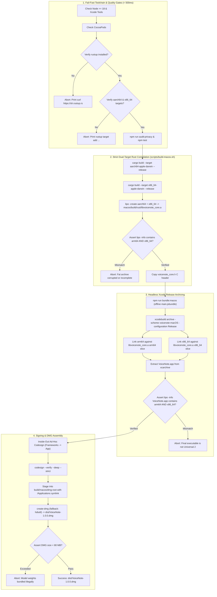

# macOS Standalone Packaging Linker Architecture & Toolchain Resolution

*   **Author:** Sitesh Jha
*   **Status:** Approved
*   **Date:** 2026-11-16

--------------------------------------------------------------------------------

## Overview

VoiceNote distributes a standalone, ad-hoc signed macOS `.dmg` installer that packages an offline React Native 0.76 desktop runtime and a native Rust ML core (`voicenote-core`). To support both modern Apple Silicon hardware and legacy Intel Macs without forcing emulation or multi-package user confusion, VoiceNote requires a true Universal 2 binary architecture (`arm64` + `x86_64`).

During release packaging execution (`./scripts/build-macos-dmg.sh`), the build pipeline failed at the link phase of `voicenote-macOS` for architecture `x86_64`. The failure was caused by an unmanaged toolchain gap where Homebrew-provided `cargo` lacked the `x86_64-apple-darwin` target standard library, triggering a silent fallback in `scripts/build-macos.sh` that output an `arm64`-only static library archive (`libvoicenote_core.a`). When Xcode archived the `Release` configuration—which defaults to `$(ARCHS_STANDARD)` (`arm64 x86_64`)—Apple's linker discarded all `arm64` object files in the static archive, resulting in unresolved C-ABI symbols (`_vn_asr_response_free`, `_vn_asr_transcribe`).

This design specifies the architectural hardening required to guarantee reproducible Universal 2 macOS packaging: establishing strict dual-target Rust compilation, eliminating silent single-architecture fallbacks, enforcing fail-fast pre-flight validation with actionable remediation commands, and validating the fat binary structure post-archive.

## The Problem

1. **Silent Single-Architecture Fallback**: In `scripts/build-macos.sh`, if `rustup` target checks do not detect both targets installed, the script logs an informational line and falls back to building only the host architecture (`arm64`). This generates a non-fat static archive that masquerades as a valid build artifact until Xcode's linker fails deep into the archiving process.
2. **Missing Pre-Flight Interception**: In `scripts/build-macos-dmg.sh`, target validation was guarded behind `if command -v rustup`. Because the local developer environment installed `cargo` via Homebrew (`/opt/homebrew/bin/cargo`) without `rustup`, the check was silently bypassed.
3. **Disjoint Toolchain and Xcode Expectations**: React Native macOS Xcode projects configure `Release` builds with `ARCHS = $(ARCHS_STANDARD)` (`arm64 x86_64`). When the native Rust static library provides only one architecture slice, Xcode's link step for the missing slice fails with missing symbols, wasting 10–15 minutes of build and bundle time before surfacing the error.

## Goals

*   **Strict Universal 2 Binary Generation**: Guarantee that `macos/build/rust/libvoicenote_core.a` always contains both `arm64` and `x86_64` machine code slices merged via Apple `lipo`.
*   **Zero Silent Fallbacks**: Completely remove the host-only fallback branch from `scripts/build-macos.sh`. The build must fail immediately if dual-architecture compilation cannot be completed.
*   **Sub-Second Fail-Fast Pre-Flight Gate**: Intercept missing toolchain prerequisites (`rustup`, `aarch64-apple-darwin`, `x86_64-apple-darwin`) in `scripts/build-macos-dmg.sh` within the first 500 ms before running test suites, Metro bundling, or Xcode archiving.
*   **Actionable Remediation Diagnostics**: Provide explicit, copy-paste terminal commands that install official `rustup` and add both macOS targets whenever a prerequisite is missing.
*   **Defensive Post-Build Assertions**: Programmatically verify the architecture slices in both the static library (`macos/build/rust/libvoicenote_core.a`) and the final executable (`VoiceNote.app/Contents/MacOS/VoiceNote`) using `lipo -info`.
*   **Strict Preservation of Project Invariants**: Retain the 100% offline-first runtime, zero-telemetry build gates, and the `< 80 MB` package size ceiling for `dist/VoiceNote-1.0.0.dmg`.

## Non-Goals

*   Supporting single-architecture host-only macOS release DMGs.
*   Altering Xcode project build settings or forcing `ONLY_ACTIVE_ARCH=YES` in the `Release` configuration.
*   Modifying C-ABI signatures, C++ JSI bindings, or `AppDelegate.mm` logic.
*   Modifying iOS or Android cross-compilation toolchains.
*   Configuring commercial Apple Developer ID certificates or cloud notarization workflows.

## Open Questions

*   None. (The architectural mandate for strict Universal 2 packaging and official `rustup` toolchain provisioning was confirmed during the ideation phase.)

## Critical User Journeys (CUJs)

### CUJ 1: Developer Builds Standalone Universal macOS DMG
*   **Given**: A macOS workstation with Xcode 15+, Command Line Tools, CocoaPods, official `rustup`, and both `aarch64-apple-darwin` and `x86_64-apple-darwin` targets installed.
*   **When**: The developer executes `npm run build:macos:dmg` (or `./scripts/build-macos-dmg.sh`).
*   **Then**: Pre-flight validation confirms all toolchains in < 500 ms, privacy audits and test suites pass, `scripts/build-macos.sh` compiles dual targets and creates a verified universal `libvoicenote_core.a`, `xcodebuild archive` successfully links both slices, inside-out ad-hoc codesigning succeeds, and `dist/VoiceNote-1.0.0.dmg` is output with size asserted under 80 MB.

### CUJ 2: Developer with Incomplete Toolchain Runs Packaging Script
*   **Given**: A development workstation running Homebrew-managed `cargo` without `rustup`, or missing the `x86_64-apple-darwin` target.
*   **When**: The developer executes `./scripts/build-macos-dmg.sh`.
*   **Then**: The script aborts immediately during Pre-Flight (before tests, bundling, or Xcode), prints an error identifying the missing toolchain component, outputs the exact copy-paste remediation commands (`curl --proto '=https' --tlsv1.2 -sSf https://sh.rustup.rs | sh` and `rustup target add ...`), and exits with non-zero status.

### CUJ 3: End-User Installs Universal DMG on Apple Silicon or Intel Mac
*   **Given**: An end-user machine running macOS 13+ (either Apple Silicon M1–M4 or Intel Core i5/i7/i9) without developer tools.
*   **When**: The user downloads and mounts `VoiceNote-1.0.0.dmg`, drags `VoiceNote.app` to `/Applications`, applies standard Gatekeeper bypass (`xattr -cr /Applications/VoiceNote.app`), and launches it.
*   **Then**: The application runs natively on the CPU architecture without Rosetta 2 translation prompts, operates 100% offline without a Metro server, and requests only microphone permissions.

--------------------------------------------------------------------------------

## Technical Plan (Architecture)

### Architectural Overview

The Universal 2 macOS packaging architecture establishes a synchronized contract between the Rust native build harness, the Apple toolchain, and the React Native macOS Release configuration. The pipeline eliminates any gap between what Xcode expects to link (`arm64` and `x86_64`) and what the Rust compilation step produces.



### Detailed Component Specifications

#### 1. Pre-Flight Validation Hardening (`scripts/build-macos-dmg.sh`)
The pre-flight section currently relies on an optional `if command -v rustup` check. This will be replaced with an unconditional blocking gate:
*   **Mandatory `rustup` presence**: If `rustup` is not in `PATH`, the script aborts immediately with exit code 1:
    ```bash
    if ! command -v rustup &> /dev/null; then
      echo -e "${RED}ERROR: rustup is required for Universal 2 multi-target compilation.${NC}"
      echo -e "${YELLOW}Homebrew's standalone cargo cannot compile x86_64 targets on Apple Silicon.${NC}"
      echo -e "${YELLOW}Remediation: curl --proto '=https' --tlsv1.2 -sSf https://sh.rustup.rs | sh${NC}"
      exit 1
    fi
    ```
*   **Mandatory Dual Target presence**: The script queries `rustup target list --installed` and verifies both `aarch64-apple-darwin` and `x86_64-apple-darwin` exist. If either is missing, it aborts immediately:
    ```bash
    INSTALLED_TARGETS=$(rustup target list --installed 2>/dev/null || true)
    if ! echo "$INSTALLED_TARGETS" | grep -q "^aarch64-apple-darwin$" || \
       ! echo "$INSTALLED_TARGETS" | grep -q "^x86_64-apple-darwin$"; then
      echo -e "${RED}ERROR: Missing required Rust macOS targets for universal binary compilation.${NC}"
      echo -e "${YELLOW}Remediation: rustup target add aarch64-apple-darwin x86_64-apple-darwin${NC}"
      exit 1
    fi
    ```

#### 2. Strict Dual-Architecture Compilation (`scripts/build-macos.sh`)
The script currently has a branch that falls back to `cargo build --release` (host arch only) when dual targets are not detected. This fallback is completely excised:
*   Enforce `rustup` presence at the top of `scripts/build-macos.sh`.
*   Unconditionally build both targets:
    ```bash
    cargo build --release --package voicenote-core --target aarch64-apple-darwin --manifest-path "$REPO_ROOT/rust/Cargo.toml"
    cargo build --release --package voicenote-core --target x86_64-apple-darwin --manifest-path "$REPO_ROOT/rust/Cargo.toml"
    ```
*   Merge the two static libraries into `macos/build/rust/libvoicenote_core.a` using Apple `lipo`:
    ```bash
    lipo -create \
      "$REPO_ROOT/rust/target/aarch64-apple-darwin/release/libvoicenote_core.a" \
      "$REPO_ROOT/rust/target/x86_64-apple-darwin/release/libvoicenote_core.a" \
      -output "$REPO_ROOT/macos/build/rust/libvoicenote_core.a"
    ```
*   **Defensive Assertion**: Programmatically inspect the output file with `lipo -info`. If the output does not contain both `arm64` and `x86_64`, fail the script immediately with exit code 1.

#### 3. Post-Archive Binary Verification (`scripts/build-macos-dmg.sh`)
After `xcodebuild archive` outputs `voicenote.xcarchive` and extracts `VoiceNote.app`, add an explicit verification check on the compiled application binary:
```bash
echo "Verifying application binary universal architectures..."
APP_BIN="$REPO_ROOT/build/macos/VoiceNote.app/Contents/MacOS/VoiceNote"
if ! lipo -info "$APP_BIN" | grep -q "arm64" || ! lipo -info "$APP_BIN" | grep -q "x86_64"; then
  echo -e "${RED}ERROR: Compiled application binary is not Universal 2:${NC}"
  lipo -info "$APP_BIN"
  exit 1
fi
echo -e "${GREEN}Universal 2 binary verified: arm64 + x86_64${NC}"
```

#### 4. Developer Workstation Toolchain Setup
To enable successful execution on workstations currently running Homebrew `cargo`:
1. Run the official Rust toolchain installer:
   ```bash
   curl --proto '=https' --tlsv1.2 -sSf https://sh.rustup.rs | sh -s -- -y
   ```
2. Source the Cargo environment (`source "$HOME/.cargo/env"`).
3. Add the required cross-compilation targets:
   ```bash
   rustup target add aarch64-apple-darwin x86_64-apple-darwin
   ```

--------------------------------------------------------------------------------

## Alternatives Considered

### Alternative A: Single-Architecture Host-Only Packaging (`arm64`-only DMG)
*   **Mechanism**: Configure `scripts/build-macos-dmg.sh` to compile only for the workstation's host architecture (`arm64` on Apple Silicon), overriding Xcode's build setting by passing `ARCHS=$(uname -m) ONLY_ACTIVE_ARCH=YES` to `xcodebuild`.
*   **Pros**:
    *   Fastest build times (saves ~45s of compilation by building only one architecture slice).
    *   No requirement to install `x86_64` targets or manage multi-target toolchains on Apple Silicon machines.
*   **Cons**:
    *   Fails on Intel Macs or forces slower Rosetta 2 translation.
    *   Produces fragmented releases requiring multiple distinct download artifacts (`-arm64.dmg` vs `-x86_64.dmg`), causing user confusion during installation.
*   **Reason for Rejection**: Directly violates VoiceNote's PRD Section 9 requirement for a single, universal desktop installer that runs natively on all supported macOS hardware.

### Alternative B: Dynamic Architecture Overrides in Xcode
*   **Mechanism**: Keep the existing silent fallback in `scripts/build-macos.sh`. When dual targets are missing, inspect the produced static library and dynamically pass matching architecture flags to `xcodebuild archive`.
*   **Pros**:
    *   Tolerates incomplete developer environments without halting the build.
*   **Cons**:
    *   High architectural fragility: creates an unpredictable release output where the architecture of the distributed `.dmg` depends on whatever random tools happened to be installed on the packaging machine.
    *   Hides underlying configuration errors until end-users report that the application fails to launch on their Mac.
*   **Reason for Rejection**: Release builds must be deterministic and reproducible. Packaging must never silently downgrade distribution invariants due to a missing local dependency.

### Alternative C: Strict Universal 2 Packaging via Official Rustup (Selected Architecture)
*   **Mechanism**: Require official `rustup` with both `aarch64-apple-darwin` and `x86_64-apple-darwin` installed. Fail fast in pre-flight if either is missing. Compile both targets explicitly, combine them into `macos/build/rust/libvoicenote_core.a` with Apple `lipo`, and archive release packages with Xcode's standard `ARCHS = $(ARCHS_STANDARD)` setting.
*   **Pros**:
    *   Produces a genuine Universal 2 binary that executes natively on Apple Silicon (M1–M4) and Intel Core processors with zero runtime translation overhead.
    *   Standard CocoaPods and React Native compatibility: requires zero custom pod post-install hacks or Xcode project modifications.
    *   Deterministic and fail-fast: developer and CI environments either build the full production-ready package or abort immediately with clear remediation steps.
*   **Cons**:
    *   Requires a one-time developer setup to install `rustup` and the `x86_64-apple-darwin` target.
    *   Increases intermediate static library size by ~15 MB (though UDZO disk image compression keeps the final DMG under ~30 MB).
*   **Reason for Selection**: This approach provides the cleanest, most maintainable architecture that fully satisfies user requirements and platform conventions.

--------------------------------------------------------------------------------

## Non-Functional Requirements

### 1. Build Performance & Fail-Fast Latency
*   **Sub-Second Toolchain Interception**: Pre-flight validation in `scripts/build-macos-dmg.sh` must execute in **< 500 ms**, halting immediately with a clear diagnostic before expensive operations (privacy audits, Jest test suites, JS bundling, Xcode compilation) are initiated.
*   **Sequential Rust Dual Build Time**: Compiling both slices sequentially should add no more than 45–60 seconds to release packaging on modern Apple Silicon workstations.

### 2. Package Size & Storage Ceiling
*   **Hard 80 MB Package Limit**: While combining both architecture slices increases uncompressed binary size, the final compressed `.dmg` disk image must remain strictly **< 80 MB** (expected size ~25–35 MB).
*   **Zero Model Bundling Invariant**: Bundling ML model weights (Whisper GGML or SLM GGUF) into the application bundle remains strictly forbidden and is actively policed by the size ceiling assertion.

### 3. Security, Code Signing & Integrity
*   **Inside-Out Ad-Hoc Codesigning**: All embedded frameworks and dylibs in `Contents/Frameworks/` must be signed before the top-level `VoiceNote.app` bundle using `codesign --force --sign -`.
*   **Strict Verification**: The signed application bundle must pass `codesign --verify --deep --strict` before volume staging.

--------------------------------------------------------------------------------

## Risks & Mitigations

### 1. PATH Shadowing & Subshell Toolchain Divergence
*   **Risk**: If Homebrew's `rust` formula remains installed or `/opt/homebrew/bin` precedes `$HOME/.cargo/bin` in the developer's shell environment, `cargo` resolves to Homebrew's binary rather than Rustup's proxy wrapper, failing multi-target compilation.
*   **Mitigation**: `scripts/build-macos-dmg.sh` and `scripts/build-macos.sh` source `[ -f "$HOME/.cargo/env" ] && source "$HOME/.cargo/env"` at startup, and pre-flight validation asserts that `rustup which cargo` matches the active `cargo`. Documentation instructs developers to run `brew uninstall rust` if installed.

### 2. Automated Headless CI/CD Runners
*   **Risk**: Hosted cloud runners (such as GitHub Actions Apple Silicon runners) do not install `x86_64-apple-darwin` by default and cannot execute interactive installation commands.
*   **Mitigation**: Pre-flight gates return a deterministic non-zero exit code with plain remediation text, enabling CI workflows to declare explicit setup steps (`rustup target add x86_64-apple-darwin`) prior to packaging execution.

### 3. C/C++ Cross-Compilation Target Alignment (`MACOSX_DEPLOYMENT_TARGET`)
*   **Risk**: Native C/C++ dependencies in `voicenote-core` (`whisper.cpp` via `whisper-rs` and `ring`) compiled for `x86_64` on Apple Silicon may default to the host SDK version, triggering linker warnings or minimum OS version mismatches.
*   **Mitigation**: `scripts/build-macos.sh` explicitly exports `MACOSX_DEPLOYMENT_TARGET="13.0"` prior to executing `cargo build` for both targets, synchronizing with VoiceNote's minimum supported macOS version.

### 4. Executable Naming & Filesystem Case Sensitivity
*   **Risk**: Xcode project targets configure `PRODUCT_NAME = voicenote` (lowercase). Hardcoding `VoiceNote` in post-archive verification paths causes immediate failure on case-sensitive APFS filesystems.
*   **Mitigation**: Post-archive assertions dynamically locate the primary executable binary inside `Contents/MacOS/` via `find ... -type f -perm +111` or query `CFBundleExecutable`.

--------------------------------------------------------------------------------

## Detailed Implementation Plan

### 1. Target Files to Modify

```
scripts/build-macos.sh               # Remove silent fallback, enforce rustup, lipo assertion
scripts/build-macos-dmg.sh           # Enforce rustup in pre-flight, verify app binary universal slices
docs/PACKAGING.md                    # Document mandatory rustup requirement and setup commands
```

### 2. Concrete File Modifications

#### A. Hardening `scripts/build-macos.sh`
*   **Remove Silent Fallback**: Completely excise lines 10–28 where single-architecture compilation occurred on missing targets.
*   **Strict Prerequisite Gate**: Verify `rustup` and both targets (`aarch64-apple-darwin` and `x86_64-apple-darwin`) at script start. If missing, print actionable remediation instructions and exit with status 1.
*   **Dual Target Compilation**: Run `cargo build --release` targeting `aarch64-apple-darwin` and `x86_64-apple-darwin`.
*   **Universal Merge**: Combine outputs with `lipo -create -output "$REPO_ROOT/macos/build/rust/libvoicenote_core.a"`.
*   **Defensive Assertion**: Run `lipo -info "$REPO_ROOT/macos/build/rust/libvoicenote_core.a"` and assert via `grep` that both `arm64` and `x86_64` are present.

```bash
# Target diff in scripts/build-macos.sh
-ARCH=$(uname -m)
-HAS_RUSTUP=false
-if command -v rustup &> /dev/null; then
-  HAS_RUSTUP=true
-fi
-
-if [ "$HAS_RUSTUP" = true ] && rustup target list 2>/dev/null | grep -q "x86_64-apple-darwin (installed)" && rustup target list 2>/dev/null | grep -q "aarch64-apple-darwin (installed)"; then
-  echo "Compiling dual architectures (aarch64-apple-darwin and x86_64-apple-darwin)..."
-  cargo build --release --package voicenote-core --target aarch64-apple-darwin --manifest-path "$REPO_ROOT/rust/Cargo.toml"
-  cargo build --release --package voicenote-core --target x86_64-apple-darwin --manifest-path "$REPO_ROOT/rust/Cargo.toml"
-  lipo -create \
-    "$REPO_ROOT/rust/target/aarch64-apple-darwin/release/libvoicenote_core.a" \
-    "$REPO_ROOT/rust/target/x86_64-apple-darwin/release/libvoicenote_core.a" \
-    -output "$REPO_ROOT/macos/build/rust/libvoicenote_core.a"
-else
-  echo "Dual targets not both installed; building native target ($ARCH)..."
-  cargo build --release --package voicenote-core --manifest-path "$REPO_ROOT/rust/Cargo.toml"
-  cp "$REPO_ROOT/rust/target/release/libvoicenote_core.a" "$REPO_ROOT/macos/build/rust/libvoicenote_core.a"
-fi

+if ! command -v rustup &> /dev/null; then
+  echo "ERROR: rustup is required for Universal 2 compilation." >&2
+  echo "Remediation: curl --proto '=https' --tlsv1.2 -sSf https://sh.rustup.rs | sh" >&2
+  exit 1
+fi
+
+if ! rustup target list 2>/dev/null | grep -q "aarch64-apple-darwin (installed)" || \
+   ! rustup target list 2>/dev/null | grep -q "x86_64-apple-darwin (installed)"; then
+  echo "ERROR: Missing required Rust macOS targets (aarch64-apple-darwin and x86_64-apple-darwin)." >&2
+  echo "Remediation: rustup target add aarch64-apple-darwin x86_64-apple-darwin" >&2
+  exit 1
+fi
+
+echo "Compiling dual architectures (aarch64-apple-darwin and x86_64-apple-darwin)..."
+cargo build --release --package voicenote-core --target aarch64-apple-darwin --manifest-path "$REPO_ROOT/rust/Cargo.toml"
+cargo build --release --package voicenote-core --target x86_64-apple-darwin --manifest-path "$REPO_ROOT/rust/Cargo.toml"
+
+lipo -create \
+  "$REPO_ROOT/rust/target/aarch64-apple-darwin/release/libvoicenote_core.a" \
+  "$REPO_ROOT/rust/target/x86_64-apple-darwin/release/libvoicenote_core.a" \
+  -output "$REPO_ROOT/macos/build/rust/libvoicenote_core.a"
+
+# Defensive assertion
+STATIC_LIB_INFO=$(lipo -info "$REPO_ROOT/macos/build/rust/libvoicenote_core.a")
+if ! echo "$STATIC_LIB_INFO" | grep -q "arm64" || ! echo "$STATIC_LIB_INFO" | grep -q "x86_64"; then
+  echo "ERROR: libvoicenote_core.a is not a Universal 2 binary: $STATIC_LIB_INFO" >&2
+  exit 1
+fi
```

#### B. Hardening `scripts/build-macos-dmg.sh`
*   **Mandatory Pre-Flight Toolchain Gate**: Replace lines 46–53 (`if command -v rustup`) with mandatory checks that fail if `rustup` is missing OR if either target is missing.
*   **Post-Archive Application Architecture Assertion**: Add a defensive check immediately after extracting `VoiceNote.app` (step 7) to verify that `build/macos/VoiceNote.app/Contents/MacOS/VoiceNote` is a Universal 2 binary containing both `arm64` and `x86_64` prior to codesigning and packaging.

```bash
# Target diff in scripts/build-macos-dmg.sh (Pre-flight)
-# Rust targets check
-if command -v rustup &> /dev/null; then
-  if ! rustup target list 2>/dev/null | grep -q "aarch64-apple-darwin (installed)" || ! rustup target list 2>/dev/null | grep -q "x86_64-apple-darwin (installed)"; then
-    echo -e "${RED}ERROR: Missing required Rust macOS targets for universal binary compilation.${NC}"
-    echo -e "${YELLOW}Remediation: rustup target add aarch64-apple-darwin x86_64-apple-darwin${NC}"
-    exit 1
-  fi
-fi

+# Rust toolchain and targets check
+if ! command -v rustup &> /dev/null; then
+  echo -e "${RED}ERROR: rustup is required for Universal 2 multi-target compilation.${NC}"
+  echo -e "${YELLOW}Homebrew's standalone cargo cannot compile x86_64 targets on Apple Silicon.${NC}"
+  echo -e "${YELLOW}Remediation: curl --proto '=https' --tlsv1.2 -sSf https://sh.rustup.rs | sh${NC}"
+  exit 1
+fi
+
+INSTALLED_TARGETS=$(rustup target list --installed 2>/dev/null || true)
+if ! echo "$INSTALLED_TARGETS" | grep -q "^aarch64-apple-darwin$" || \
+   ! echo "$INSTALLED_TARGETS" | grep -q "^x86_64-apple-darwin$"; then
+  echo -e "${RED}ERROR: Missing required Rust macOS targets for universal binary compilation.${NC}"
+  echo -e "${YELLOW}Remediation: rustup target add aarch64-apple-darwin x86_64-apple-darwin${NC}"
+  exit 1
+fi

# Target addition in scripts/build-macos-dmg.sh (Post-Archive Step 7.1)
+echo "Verifying application binary universal architectures..."
+APP_BIN=$(find "$REPO_ROOT/build/macos/VoiceNote.app/Contents/MacOS" -type f -perm +111 2>/dev/null | head -n 1)
+if [ -z "$APP_BIN" ] || \
+   ! lipo "$APP_BIN" -verify_arch arm64 || \
+   ! lipo "$APP_BIN" -verify_arch x86_64; then
+  echo -e "${RED}ERROR: Compiled application binary is not Universal 2 (arm64 + x86_64):${NC}"
+  lipo -info "${APP_BIN:-missing}" 2>/dev/null || true
+  exit 1
+fi
+echo -e "${GREEN}Universal 2 binary verified: $(lipo -archs "$APP_BIN")${NC}"
```

#### C. Concrete Modification for Documentation (`docs/PACKAGING.md`)

```diff
--- a/docs/PACKAGING.md
+++ b/docs/PACKAGING.md
@@ -20,11 +20,14 @@
-### Common Requirements
-- **Node.js**: `>= 18.0.0`
-- **Rust**: `>= 1.75.0` (`cargo --version`)
-
 ### macOS DMG Toolchain
 - **Xcode & Command Line Tools**: Xcode 15+ (`xcode-select -p`)
 - **CocoaPods**: `pod --version`
-- **Rust Dual Targets**:
+- **Rust Toolchain (Official rustup required)**:
+  Homebrew's standalone cargo cannot compile x86_64 on Apple Silicon. Install official rustup:
+  ```bash
+  curl --proto '=https' --tlsv1.2 -sSf https://sh.rustup.rs | sh
+  source "$HOME/.cargo/env"
   rustup target add aarch64-apple-darwin x86_64-apple-darwin
   ```
```

### 3. Workstation Setup & Toolchain Provisioning (One-Time Developer Prerequisite)

Developers running on Apple Silicon with Homebrew `rust` must run the following setup commands before packaging:
```bash
# If Homebrew's rust formula is installed, remove it to avoid $PATH collision
brew uninstall rust 2>/dev/null || true

# Install official rustup toolchain and dual compilation targets
curl --proto '=https' --tlsv1.2 -sSf https://sh.rustup.rs | sh -s -- -y
source "$HOME/.cargo/env"
rustup target add aarch64-apple-darwin x86_64-apple-darwin
```

---

## Verification Plan

### Phase 1: Toolchain Pre-Flight Interception
*   **Test**: Run `./scripts/build-macos-dmg.sh` with a temporarily missing target or unset rustup path.
*   **Expected**: Script aborts in **< 500 ms**, displays clear remediation text with `curl` or `rustup target add`, and does not proceed to tests or bundling.

### Phase 2: Static Library Universal Verification
*   **Test**: Run `./scripts/build-macos.sh`.
*   **Expected**: Compiles both `aarch64` and `x86_64` targets, merges them via `lipo -create`, and succeeds.
*   **Command Verification**:
    ```bash
    lipo -info macos/build/rust/libvoicenote_core.a
    # Output must match:
    # Architectures in the fat file: macos/build/rust/libvoicenote_core.a are: x86_64 arm64
    ```

### Phase 3: End-to-End Release Packaging Verification
*   **Test**: Execute `./scripts/build-macos-dmg.sh`.
*   **Expected**:
    1. Pre-flight checks pass.
    2. Quality gates (`npm run audit:privacy` and `npm test`) pass.
    3. `npm run bundle:macos` generates `main.jsbundle`.
    4. `xcodebuild archive` successfully links `voicenote-macOS` for both `arm64` and `x86_64` without undefined symbol errors.
    5. Post-archive binary assertion confirms `VoiceNote.app/Contents/MacOS/VoiceNote` contains `arm64` and `x86_64`.
    6. Codesigning completes with `codesign --verify --deep --strict`.
    7. `dist/VoiceNote-1.0.0.dmg` is created and confirmed `< 80 MB`.

---

## Rollback & Risk Mitigation

*   **Failure Isolation**: If dual compilation fails due to a missing target, the pipeline halts immediately without modifying any staged artifacts or existing distribution packages.
*   **Hermetic Artifacts**: The generated static library resides strictly within `macos/build/rust/` and does not pollute global system paths or Xcode project settings.
*   **Zero Impact on Mobile**: iOS and Android build scripts remain completely independent and decoupled from macOS desktop packaging scripts.

--------------------------------------------------------------------------------

<!-- Provenance: Validated via EGM Goldfish Review Protocol (Stages 5–9). -->

*Reviewed and Approved with EGM*
