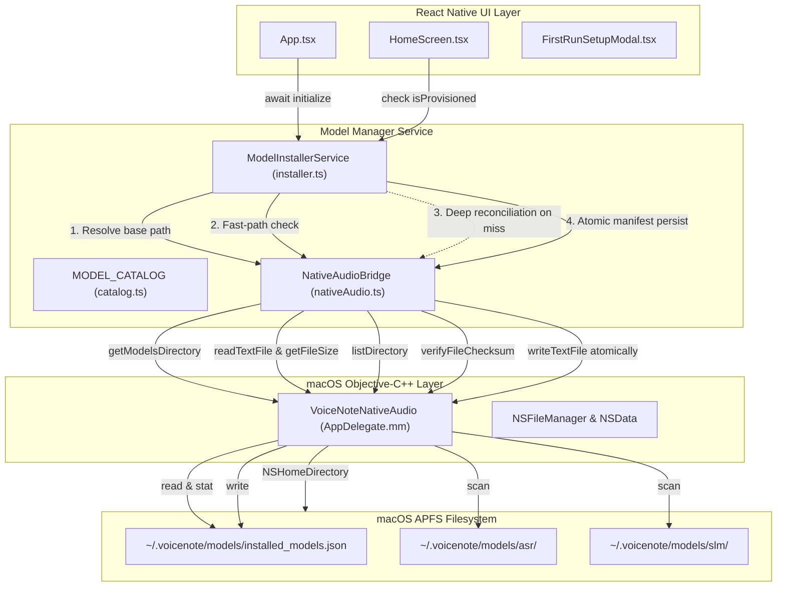
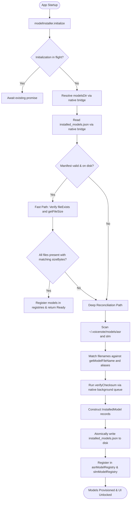

# Persistent On-Disk Model Management & macOS Cold-Start Reconciliation

* **Author:** Sitesh Jha
* **Status:** Draft
* **Date:** 2026-11-17

---

## Overview

VoiceNote is a local, private speech-to-text dictation application with on-device tone rewriting. The application operates without cloud inference, using local Whisper Automatic Speech Recognition (ASR) and Qwen2.5 Small Language Model (SLM) model weights totaling ~639 MB in GGUF model binary format. 

On macOS desktop, closing and reopening the application currently erases all registration of installed models, requiring the user to re-download 639 MB on every launch. This design document establishes an on-disk manifest and cold-start disk reconciliation architecture to ensure downloaded model weights persist permanently across restarts and are verified without blocking startup responsiveness.

## The Problem

VoiceNote relies on an in-memory Node filesystem shim (`src/shims/fs.js`) inside the React Native bundle. When model weights are downloaded, `ModelInstallerService` writes the installation manifest (`installed_models.json`) to this in-memory Map rather than physical disk storage. When the user quits the application, the JavaScript process terminates, destroying all records of installed models. 

Simultaneously, `installer.ts` resolves filesystem paths using `os.homedir()`, which returns `"/"` in React Native's browser polyfill. This produces an invalid path (`"/.voicenote/models"`) targeting the read-only root system partition. When the app starts again, the manifest is missing, `isProvisioned()` returns false, and the user is repeatedly prompted to re-download 639 MB of offline models.

Furthermore, if valid model weights already exist on disk (from a prior session or manual placement), the application fails to detect them on startup, lacking any disk reconciliation mechanism.

## Goals

* **Permanent Model Retention**: Persist installed model registration directly to a physical JSON manifest on disk (`~/.voicenote/models/installed_models.json`) that survives process termination.
* **Deterministic Path Alignment**: Ensure both JavaScript and native Objective-C++ runtimes resolve identical directory paths rooted in the user's home directory (`~/.voicenote/models/`).
* **Sub-10ms Startup on Valid Manifest (Fast Path)**: If the physical manifest exists and referenced files match expected byte sizes, complete model registration in `< 10 ms` without blocking the main UI thread.
* **Cold-Start Disk Reconciliation (Deep Path)**: If the manifest is missing or damaged but model files exist on disk, scan the directories, verify their cryptographic SHA-256 checksums in the background, auto-generate the manifest, and register the engines.
* **Zero Unnecessary Network Requests**: Guarantee zero repeated model download prompts when valid model weights exist on disk.
* **Targeted Corrupt Weight Recovery**: If a physical file fails checksum verification, surface a toast notification identifying the specific damaged model ID rather than failing silently or prompting a full 639 MB bundle re-download.

## Non-Goals

* **Bundling Model Weights in Binary**: Model weights will not be bundled directly into the macOS `.app` bundle or DMG installer (prohibited by repository size limits and project context constraints).
* **Modifying Core ML Runtimes**: No changes to the underlying Whisper GGUF engine, Llama GGUF engine, or model quantization schemes (Q5_1 for Whisper, Q4_K_M for Qwen2.5).
* **Third-Party NPM Dependencies**: No external file-system libraries (e.g. `react-native-fs`, `expo-file-system`) will be added to the project.
* **Cloud Sync / Telemetry**: Model status and manifests remain 100% offline with zero cloud tracking.

## Open Questions

* **Question 1**: How should the application handle permissions if a user runs VoiceNote under macOS App Sandbox with a custom container path versus non-sandboxed terminal execution?
  - *Resolution*: Delegate path expansion entirely to the native layer (`[NSHomeDirectory() stringByAppendingPathComponent:@".voicenote/models"]`) so the operating system automatically resolves the correct sandbox container or user home folder.

## Critical User Journeys (CUJs)

### CUJ 1: Clean First-Time Provisioning and Persistence
* **Given**: A fresh installation of VoiceNote on macOS with no models installed.
* **When**: The user opens the app, sees the offline model setup modal, and downloads the models.
* **Then**: `ModelDownloader` saves the models to `~/.voicenote/models/asr/` and `~/.voicenote/models/slm/`. An atomic write creates `~/.voicenote/models/installed_models.json`. When the user quits and restarts the app, the app opens directly to the recording interface with models marked as ready.

### CUJ 2: Recovery from Missing or Damaged Manifest with Existing Weights
* **Given**: The user has valid Whisper and Qwen weights on disk in `~/.voicenote/models/`, but `installed_models.json` is deleted or corrupted.
* **When**: The user launches the app.
* **Then**: The cold-start reconciler detects the missing manifest, scans the directories, verifies SHA-256 hashes against `MODEL_CATALOG`, recreates `installed_models.json`, and enables dictation without prompting for a download.

### CUJ 3: Damaged Weight Detection and Targeted Remediation
* **Given**: A partially downloaded or corrupted file exists in `~/.voicenote/models/asr/`.
* **When**: Deep reconciliation runs on startup or during verification.
* **Then**: `VoiceNoteNativeAudio.verifyFileChecksum` detects the checksum mismatch. `ModelInstallerService` marks only that model as unverified, presents an inline prompt to re-download only the damaged 148 MB Whisper model, and preserves the valid Qwen SLM model.

---

## Technical Plan (Architecture)

### 1. Component Architecture & Data Flow



### 2. Native Physical File I/O Primitives (`AppDelegate.mm`)

To replace the ephemeral `src/shims/fs.js` without pulling in third-party native dependencies, `VoiceNoteNativeAudio` in `macos/voicenote-macOS/AppDelegate.mm` exposes six asynchronous primitives (complementing pre-existing `verifyFileChecksum` and `moveFile`):

```objc
// Returns ~/.voicenote/models using NSHomeDirectory(), creating the folder if missing
RCT_EXPORT_METHOD(getModelsDirectory:(RCTPromiseResolveBlock)resolve
                  rejecter:(RCTPromiseRejectBlock)reject);

// Reads string contents from disk using UTF-8 encoding. Resolves [NSNull null] if file does not exist.
RCT_EXPORT_METHOD(readTextFile:(NSString *)filePath
                  resolver:(RCTPromiseResolveBlock)resolve
                  rejecter:(RCTPromiseRejectBlock)reject);

// Recursively creates parent directories and atomically writes UTF-8 string contents to disk
RCT_EXPORT_METHOD(writeTextFile:(NSString *)filePath
                  content:(NSString *)content
                  resolver:(RCTPromiseResolveBlock)resolve
                  rejecter:(RCTPromiseRejectBlock)reject);

// Checks if a physical file exists at path
RCT_EXPORT_METHOD(fileExists:(NSString *)filePath
                  resolver:(RCTPromiseResolveBlock)resolve
                  rejecter:(RCTPromiseRejectBlock)reject);

// Returns file size in bytes as NSNumber, or -1 if the file does not exist
RCT_EXPORT_METHOD(getFileSize:(NSString *)filePath
                  resolver:(RCTPromiseResolveBlock)resolve
                  rejecter:(RCTPromiseRejectBlock)reject);

// Lists directory filenames as an array of strings. Resolves @[] if the directory does not exist.
RCT_EXPORT_METHOD(listDirectory:(NSString *)dirPath
                  resolver:(RCTPromiseResolveBlock)resolve
                  rejecter:(RCTPromiseRejectBlock)reject);
```

*Execution Queue & Error Semantics*: All disk operations execute on `dispatch_get_global_queue(DISPATCH_QUEUE_PRIORITY_DEFAULT, 0)` to guarantee zero main-thread blocking.

### 3. NativeAudioBridge TypeScript Contract (`src/native/nativeAudio.ts`)

`NativeAudioBridge` wraps these native methods with strict type definitions and provides safe fallbacks when running in Node.js/Jest test environments where `NativeModules.VoiceNoteNativeAudio` is undefined:

```typescript
export interface NativeAudioBridge {
  getModelsDirectory(): Promise<string>;
  readTextFile(filePath: string): Promise<string | null>;
  writeTextFile(filePath: string, content: string): Promise<boolean>;
  fileExists(filePath: string): Promise<boolean>;
  getFileSize(filePath: string): Promise<number>;
  listDirectory(dirPath: string): Promise<string[]>;
  verifyFileChecksum(filePath: string, expectedSha256: string): Promise<boolean>;
  moveFile(sourcePath: string, targetPath: string): Promise<boolean>;
}
```

*Jest / Node Fallback Implementation*:
* `getModelsDirectory()`: Returns `path.join(os.tmpdir(), 'voicenote_test_models')`.
* `readTextFile(p)`: Returns `fs.existsSync(p) ? fs.readFileSync(p, 'utf8') : null`.
* `writeTextFile(p, c)`: Recursively creates parent directory and executes `fs.writeFileSync(p, c, 'utf8')`.
* `fileExists(p)`: Returns `fs.existsSync(p)`.
* `getFileSize(p)`: Returns `fs.existsSync(p) ? fs.statSync(p).size : -1`.
* `listDirectory(p)`: Returns `fs.existsSync(p) ? fs.readdirSync(p) : []`.

### 4. Manifest Schema & Two-Tier Lifecycle in `ModelInstallerService` (`installer.ts`)

#### Manifest Data Schema (`installed_models.json`)
The manifest persists an array of `InstalledModel` records:
```typescript
export interface InstalledModel {
  id: string;
  kind: 'asr' | 'slm';
  displayName: string;
  sizeBytes: number;
  version: string;
  localPath: string;
  installedAt: string;
}
```

#### Lifecycle Architecture



#### Tier 1: Fast Path (< 10 ms Manifest Hit)
1. Read `~/.voicenote/models/installed_models.json` using `nativeAudio.readTextFile()`.
2. Parse JSON. For each model entry:
   - Call `await nativeAudio.fileExists(model.localPath)`.
   - Call `await nativeAudio.getFileSize(model.localPath)` and confirm it matches `model.sizeBytes`.
3. If all mandatory models (ASR + SLM) exist on disk with valid sizes, populate `installedModels` Map and register them with `asrModelRegistry` and `slmModelRegistry`.
4. Total elapsed time: `< 10 ms`. Zero main-thread blocking or heavy SHA-256 calculation.

#### Tier 2: Deep Reconciliation (Manifest Miss / Damaged File Recovery)
1. If manifest file is missing, empty, or unparseable:
2. Ensure `modelsDir/asr` and `modelsDir/slm` subdirectories exist, then read directory contents using `nativeAudio.listDirectory()`.
3. Match found filenames against `getModelFileName(spec)` and known model aliases (`ggml-*.bin`).
4. For candidate matches, verify integrity using `verifyChecksum(filePath, spec.sha256)` from `@/services/modelManager/verifier`.
5. On successful match, create `InstalledModel` record with current timestamp.
6. Persist constructed list atomically to `~/.voicenote/models/installed_models.json` via `nativeAudio.writeTextFile()`.
7. Register validated models into `asrModelRegistry` and `slmModelRegistry`.

### 5. UI Startup Synchronization (`HomeScreen.tsx` & `App.tsx`)

To avoid modal flashing or race conditions:
1. `App.tsx` calls `modelInstaller.initialize()` during startup `useEffect`.
2. `HomeScreen.tsx` tracks `isInitializingModels` state.
3. While `isInitializingModels` is true, `AnimatedRecordButton` receives `disabled={true}` and renders `<ActivityIndicator size="small" color={theme.primary} />`.
4. Tapping record button awaits `modelInstaller.initialize()` before evaluating `isProvisioned()`, guaranteeing that `showSetupModal` is never triggered when models exist on disk.

---

## Alternatives Considered

### Alternative A: MMKV Key-Value Persistence Only

* **Pros**: Simple JavaScript-only implementation using existing `react-native-mmkv` module; no modifications needed in `AppDelegate.mm`.
* **Cons**: Fails to generate physical files on disk; external developer tools, CLI build scripts, and local shell utilities cannot inspect which models are currently installed.
* **Reason for Rejection**: The project owner specifically mandated maintaining physical manifest files on disk (`~/.voicenote/models/installed_models.json`) to allow inspection and parity with native scripts.

### Alternative B: Pure Dynamic Directory Scanning (Stateless, No Manifest)

* **Pros**: Eliminates the need to maintain an `installed_models.json` manifest file altogether.
* **Cons**: Incurs disk I/O and SHA-256 hashing overhead on every single startup; cannot retain installation timestamps, version history, or custom display names without parsing GGUF file metadata.
* **Reason for Rejection**: Re-hashing 639 MB on every boot introduces 300–800 ms of latency on cold start. Maintaining a physical manifest with fallback reconciliation gives sub-10ms boot times while still recovering from damaged or missing manifests.

### Alternative C: Third-Party Native Filesystem Library (`react-native-fs`)

* **Pros**: Pre-packaged cross-platform filesystem API for React Native.
* **Cons**: Adds a heavy third-party native dependency to the repository, increases maintenance overhead, risks dependency conflicts with React Native macOS 0.76, and violates repository contributor rules against third-party dependency bloat.
* **Reason for Rejection**: `VoiceNoteNativeAudio` already bridges native audio and file operations. Adding small native methods to `AppDelegate.mm` keeps the project clean, zero-dependency, and fully controlled.

### Alternative D: Synchronous Main-Thread File Hashing on Startup

* **Pros**: Guarantees cryptographically verified weights before the first JavaScript frame renders.
* **Cons**: Blocks the main UI thread during application launch, resulting in macOS beachballing.
* **Reason for Rejection**: Two-tier verification provides identical safety by verifying physical presence and size instantly, while executing cryptographic checksums off the main thread.

---

## Non-Functional Requirements

### Performance & Latency
* **Cold-Start Launch Budget**: Model registry loading on Tier 1 (manifest hit) must complete within `< 10 ms`.
* **Memory Budget**: File reading and writing operations in native Objective-C++ must operate using buffered streams or lightweight string allocations, adhering to the project's `< 500 MB` RAM budget.
* **Thread Safety**: Deep reconciliation and file hashing must execute strictly on a background queue (`DISPATCH_QUEUE_PRIORITY_DEFAULT`), never blocking the UI main thread.

### Privacy & Data Integrity
* **Atomic Writes**: `installed_models.json` must be written atomically (`writeToFile:atomically:YES`) to prevent zero-byte files if the process is terminated mid-write.
* **Zero Cloud Inference**: Model management remains 100% offline. No telemetry or network calls occur during model listing, verification, or reconciliation.

---

## Detailed Implementation Plan

### Target Files to Create/Modify

#### 1. `macos/voicenote-macOS/AppDelegate.mm` (Modify)
* **Type / Scope**: Native macOS Objective-C++ module (`VoiceNoteNativeAudio`).
* **Proposed Changes**: 
  - Add `RCT_EXPORT_METHOD(getModelsDirectory:...)` returning `~/.voicenote/models` via `NSHomeDirectory()` with recursive directory creation.
  - Add `RCT_EXPORT_METHOD(readTextFile:...)` reading text via `[NSString stringWithContentsOfFile:encoding:error:]`. Resolves `[NSNull null]` if file does not exist; rejects only on read I/O error.
  - Add `RCT_EXPORT_METHOD(writeTextFile:...)` ensuring parent directories exist via `createDirectoryAtPath:withIntermediateDirectories:YES`, then writing string atomically via `writeToFile:atomically:YES encoding:NSUTF8StringEncoding error:&error`.
  - Add `RCT_EXPORT_METHOD(fileExists:...)` returning boolean from `[[NSFileManager defaultManager] fileExistsAtPath:filePath]`.
  - Add `RCT_EXPORT_METHOD(getFileSize:...)` returning `NSNumber` file size via `[[[NSFileManager defaultManager] attributesOfItemAtPath:filePath error:nil] fileSize]`, or `-1` if missing.
  - Add `RCT_EXPORT_METHOD(listDirectory:...)` returning `NSArray<NSString *>` from `contentsOfDirectoryAtPath:dirPath error:&error]`. Resolves empty array `@[]` if directory does not exist.
  - Dispatch file I/O operations to `dispatch_get_global_queue(DISPATCH_QUEUE_PRIORITY_DEFAULT, 0)`.

#### 2. `src/native/nativeAudio.ts` (Modify)
* **Type / Scope**: TypeScript native bridge interface and wrapper class `NativeAudioBridge`.
* **Proposed Changes**:
  - Add typed method signatures to `NativeAudioBridge` class: `getModelsDirectory()`, `readTextFile()`, `writeTextFile()`, `fileExists()`, `getFileSize()`, `listDirectory()`.
  - Wire each method to invoke `NativeModules.VoiceNoteNativeAudio`.
  - Implement concrete mock fallbacks using Node `fs` and `os.tmpdir()` when `nativeAudio.isNativeAvailable` is false so Node.js/Jest tests pass without hardware.

#### 3. `src/services/modelManager/installer.ts` (Modify)
* **Type / Scope**: Model installation and registry management service (`ModelInstallerService`).
* **Proposed Changes**:
  - Replace direct calls to `src/shims/fs.js` with `nativeAudio` physical I/O methods.
  - Maintain `getModelsDirectory(): string` as a synchronous getter returning `this.modelsDir`, initialized to a safe fallback and updated upon completion of `initialize()`.
  - Implement async `initialize(): Promise<void>` guarded by single-flight mutex `initializationPromise`.
  - Implement Tier 1 Fast Path: read `installed_models.json`, check `fileExists` and `getFileSize` against `spec.sizeBytes`, and register models in `< 10 ms`.
  - Implement Tier 2 Deep Reconciliation: scan `asr/` and `slm/` subdirectories, match against `getModelFileName(spec)` and known aliases, run `verifyChecksum`, auto-populate `installed_models.json`, and register engines.
  - Update `persistManifest()` to write via `nativeAudio.writeTextFile()`.

#### 4. `src/services/modelManager/downloader.ts` (Modify)
* **Type / Scope**: Model download orchestrator (`ModelDownloader`).
* **Proposed Changes**:
  - Verify that `downloadModel` continues to receive `modelsDir` directly as an argument from `installer.ts` without attempting unsupported path resolutions.

#### 5. `src/screens/HomeScreen.tsx` (Modify)
* **Type / Scope**: Main recording screen component.
* **Proposed Changes**:
  - Add `isInitializingModels` state in `useEffect` awaiting `modelInstaller.initialize()`.
  - Pass `disabled={isInitializingModels}` to `AnimatedRecordButton` and render `<ActivityIndicator size="small" />` while initializing.
  - Guard `handleStartRecording` to await initialization before checking `modelInstaller.isProvisioned()`, preventing false-positive setup modal triggers.

#### 6. `App.tsx` (Modify)
* **Type / Scope**: Root application entry point.
* **Proposed Changes**:
  - Trigger `modelInstaller.initialize()` in startup `useEffect` concurrently with the native smoke test.

#### 7. `tests/modelInstaller.reconciliation.test.ts` (Create)
* **Type / Scope**: Automated Jest unit test suite.
* **Proposed Changes**:
  - Test Tier 1 Fast Path: verify instant registration and size matching from a pre-seeded manifest.
  - Test Tier 2 Deep Reconciliation: verify that unmanifested model files with valid checksums are automatically scanned, manifested, and registered.
  - Test Corrupt File Recovery: verify that files failing checksum or size matching are omitted from the manifest and flagged for re-download.
  - Test Cold-Start Persistence: simulate app restart by re-initializing service and verifying that manifest on disk is restored.
  - Test Single-Flight Concurrency: verify that `Promise.all([modelInstaller.initialize(), modelInstaller.initialize()])` returns identical results without duplicate disk reads.
  - Test Empty Models Directory: verify that launching with an empty directory cleanly resolves `isProvisioned() === false` without throwing.

#### 8. `docs/TASKS.md` (Modify)
* **Type / Scope**: Project task tracking documentation.
* **Proposed Changes**:
  - Add Phase 10 task checklist items for macOS Persistent On-Disk Model Management & Cold-Start Reconciliation.

---

## Verification Plan

* **Typecheck**: Execute `npm run typecheck` (`tsc --noEmit`); verify 0 errors.
* **Lint**: Execute `npm run lint` (`eslint src/`); verify 0 errors.
* **Privacy Audit**: Execute `npm run audit:privacy`; confirm zero forbidden network calls or unapproved libraries.
* **Automated Unit Tests**: Execute `npm test`; ensure all assertions in `tests/modelInstaller.reconciliation.test.ts` pass.
* **Cold-Start Manual Verification**:
  1. Download models in macOS VoiceNote desktop build.
  2. Confirm `~/.voicenote/models/installed_models.json` exists on disk with valid file paths and metadata.
  3. Terminate the app process (`Command+Q`).
  4. Relaunch the app. Confirm the app boots straight to recording mode with models ready, without displaying `FirstRunSetupModal`.

---

<!-- Provenance: Indicates structural drafting and multi-lens review via EGM. -->

*Drafted with EGM*
