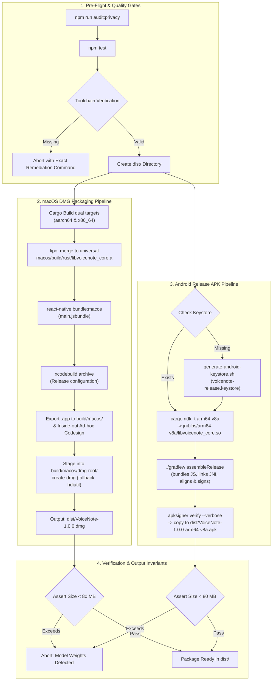

# Standalone Android APK & macOS DMG Production Packaging

*   **Author:** Sitesh Jha
*   **Status:** Draft
*   **Date:** 2026-11-15

---

## Overview

VoiceNote is an on-device, privacy-first transcription and tone rewriting mobile and desktop application. The product currently runs in development environments on macOS via React Native 0.76 and Nitro Modules JSI bindings to `rust/voicenote-core`. However, there are no reproducible standalone packaging configurations to compile, bundle, and distribute release packages without an active Metro development server. 

This document defines the production packaging architecture for two target platforms:
1. **macOS Desktop**: A standalone, ad-hoc signed `.dmg` installer containing a universal native binary (`arm64` and `x86_64` compiled via `lipo`), pre-compiled JavaScript bundle (`main.jsbundle`), and embedded application assets.
2. **Android Mobile**: A standalone signed `.apk` installer containing the bundled JavaScript (`index.android.bundle`), bootstrapped React Native 0.76 Gradle/NDK harness, cross-compiled Rust JNI libraries (`libvoicenote_core.so` for `arm64-v8a`), and automated local release keystore provisioning.

Both packaging pipelines strictly enforce the project's non-negotiable operational invariants: 100% offline-first runtime, zero telemetry, on-demand post-install model downloading, and an automated size ceiling of 80 MB on installer artifacts.

## The Problem

1. **Missing Standalone Runtime Bundling**: Current execution depends on a local Node.js Metro bundler running in the background. Generating release binaries that operate autonomously requires embedding offline JavaScript bundles and static assets into native distribution packages.
2. **Uninitialized Android Build Tree**: The repository contains only [`android/app/src/main/AndroidManifest.xml`](file:///Users/siteshjha/Desktop/projects/github/VoiceNote/android/app/src/main/AndroidManifest.xml). The Android Gradle plugin infrastructure, settings, NDK toolchains, JNI symbols, and native audio capture modules are missing. Consequently, no APK can be compiled or assembled.
3. **Lack of Headless macOS Release Tooling**: macOS execution currently relies on local Xcode debug builds. There is no automated, headless script to build release archives, merge dual-architecture static Rust libraries, apply ad-hoc signatures, and generate end-user `.dmg` disk images with `/Applications` drag-and-drop symlinks.
4. **Model Weight Bloat Risk**: If Whisper GGML (~145 MB) or SLM GGUF (~350 MB) weights are inadvertently copied into application asset directories during packaging, the installer size balloons to > 500 MB. This violates PRD constraints and causes out-of-memory errors during application installation and decompression.
5. **Security & Signing UX Barriers**: Distributing unsigned or ad-hoc signed binaries triggers OS-level friction: Apple Gatekeeper flags ad-hoc macOS apps as damaged, and Android displays "Install unknown apps" warnings during sideloading. Without explicit documentation and streamlined workflows, developers and testers cannot run the produced artifacts.

## Goals

*   **Universal macOS DMG Installer**: Provide `scripts/build-macos-dmg.sh` to generate an ad-hoc signed, drag-and-drop `.dmg` installer containing universal `arm64` and `x86_64` native binaries.
*   **Standalone Android Release APK**: Provide `scripts/build-android-release.sh` to scaffold and compile a standalone signed `.apk` (targeting `arm64-v8a`) runnable without a development machine or Metro server.
*   **Android Gradle & JNI Infrastructure**: Bootstrap the missing React Native 0.76 Gradle project tree (`android/build.gradle`, `settings.gradle`, `app/build.gradle`, Gradle wrapper, Kotlin entry points) and JNI bridge to `rust/voicenote-core`.
*   **Automated Keystore Provisioning**: Provide `scripts/generate-android-keystore.sh` to provision a local development release signing keystore automatically, while supporting external CI secrets via environment variables (`VN_KEYSTORE_PATH`, `VN_KEYSTORE_PASSWORD`, `VN_KEY_ALIAS`, `VN_KEY_PASSWORD`).
*   **Fail-Fast Toolchain Pre-flight**: Abort packaging immediately with clear, copy-paste remediation commands if any prerequisite dependency (JDK 17, Android NDK r26b/r27, `cargo-ndk`, Rust targets, `create-dmg`) is absent.
*   **Enforced Binary Size Assertion**: Guarantee that all generated `.apk` and `.dmg` files remain strictly under 80 MB, preventing accidental bundling of ML model weights.
*   **Comprehensive Documentation**: Author `docs/PACKAGING.md` documenting prerequisite setup, build execution, verification commands, and Gatekeeper/sideloading installation bypasses.

## Non-Goals

*   Publishing to the Google Play Store or configuring Google Play App Bundles (`.aab`).
*   Configuring paid Apple Developer ID credentials or cloud-based `xcrun notarytool` notarization.
*   Windows (`react-native-windows`) or Linux desktop packaging.
*   In-app self-updating or delta binary distribution.
*   Bundling speech recognition (Whisper) or language model (SLM) weights into the installation binaries.

## Open Questions

*   None. (All core trade-offs regarding ad-hoc signing, universal binary compilation, automated keystores, and size enforcement were resolved during ideation.)

## Critical User Journeys (CUJs)

### CUJ 1: Developer Builds Standalone macOS DMG

*   **Given**: A macOS workstation with Xcode 15+, Command Line Tools, CocoaPods, Rust with `aarch64-apple-darwin` and `x86_64-apple-darwin` targets, and `create-dmg` installed.
*   **When**: The developer executes `npm run build:macos:dmg` (or `./scripts/build-macos-dmg.sh`).
*   **Then**: The script validates dependencies, runs privacy audits and unit tests, compiles universal `libvoicenote_core.a` using `lipo`, bundles `main.jsbundle`, archives the release workspace, exports the `.app`, applies inside-out ad-hoc codesigning, stages the bundle into `dmg-root`, creates `dist/VoiceNote-1.0.0.dmg`, asserts file size < 80 MB, and exits with code 0.

### CUJ 2: Developer Builds Standalone Android APK

*   **Given**: A development workstation with JDK 17, Android SDK 34, Android NDK r26b/r27, `cargo-ndk`, and Rust targets `aarch64-linux-android` installed.
*   **When**: The developer executes `npm run build:android:release` (or `./scripts/build-android-release.sh`).
*   **Then**: The script validates dependencies, checks for a release keystore (generating one via `scripts/generate-android-keystore.sh` if missing), cross-compiles `libvoicenote_core.so` via `cargo ndk`, executes `./gradlew assembleRelease` (which compiles JS bundles, links JNI, aligns, and signs the release APK), verifies signature via dynamic `apksigner verify --verbose`, copies to `dist/VoiceNote-1.0.0-arm64-v8a.apk`, asserts file size < 80 MB, and exits with code 0.

### CUJ 3: End-User Installs macOS DMG with Gatekeeper Bypass

*   **Given**: A macOS device running macOS 13+ with no developer tools installed.
*   **When**: The user opens `VoiceNote-1.0.0.dmg`, drags `VoiceNote.app` to `/Applications`, and launches it.
*   **Then**: If macOS Gatekeeper displays an "unidentified developer" warning, the user follows the documented bypass (secondary-click -> Open, or runs `xattr -cr /Applications/VoiceNote.app`), allowing the app to launch completely offline without a Metro bundler.

### CUJ 4: End-User Sideloads Android APK

*   **Given**: An Android device running Android 10+ (API 29+) with "Install unknown apps" enabled for their file manager/browser.
*   **When**: The user downloads and taps `VoiceNote-1.0.0-arm64-v8a.apk` to install.
*   **Then**: Android Package Installer installs the application, requesting only the `RECORD_AUDIO` permission. On launch, the application loads offline, displays the first-run model provisioning modal, and functions independently of external dev servers.

---

## Technical Plan (Architecture)

### Architectural Overview

The standalone packaging architecture is divided into two decoupled platform pipelines with shared pre-flight validation and output isolation.



### Component Details & Subsystems

#### 1. Pre-Flight Diagnostics Subsystem
Both build scripts execute strict pre-flight environment checks before invoking compilers. If a dependency is missing, the script prints an actionable ANSI-colored error message and exits with status `1`.

| Platform | Dependency | Required Version / Check | Remediation Command on Failure |
|---|---|---|---|
| macOS & Android | Node.js | `>= 18.0.0` | `nvm use 18 || brew install node@18` |
| macOS | Xcode & CLT | Xcode 15+, `xcode-select -p` | `xcode-select --install` |
| macOS | CocoaPods | `pod --version` | `sudo gem install cocoapods || brew install cocoapods` |
| macOS | Rust macOS Targets | `aarch64-apple-darwin`, `x86_64-apple-darwin` | `rustup target add aarch64-apple-darwin x86_64-apple-darwin` |
| macOS | create-dmg | `create-dmg --version` | `brew install create-dmg` (Note: script falls back to `hdiutil` if absent) |
| Android | JDK | Java 17 (`javac -version`) | `brew install openjdk@17 && sudo ln -sfn ...` |
| Android | Android SDK | Platform 34, `ANDROID_HOME` set | `export ANDROID_HOME=$HOME/Library/Android/sdk` |
| Android | Android NDK | NDK r26b or r27, `ANDROID_NDK_HOME` set | `export ANDROID_NDK_HOME=$ANDROID_HOME/ndk/26.1.10909125` |
| Android | apksigner | In `$ANDROID_HOME/build-tools/` | `APKSIGNER=$(ls -1 "$ANDROID_HOME/build-tools/"*/apksigner 2>/dev/null \| tail -n 1)` |
| Android | cargo-ndk | `cargo-ndk --version` | `cargo install cargo-ndk` |
| Android | Rust Android Targets | `aarch64-linux-android` | `rustup target add aarch64-linux-android` |

#### 2. macOS Universal DMG Packaging Architecture (`scripts/build-macos-dmg.sh`)
*   **Path Anchoring**:
    Scripts resolve the workspace root cleanly:
    ```bash
    REPO_ROOT="$(cd "$(dirname "$0")/.." && pwd)"
    cd "$REPO_ROOT"
    ```
*   **Dual Architecture Compilation & Lipo Merging**:
    Compiles dual static library slices in `$REPO_ROOT/rust` and merges them via `lipo`:
    ```bash
    cargo build --release --package voicenote-core --target aarch64-apple-darwin --manifest-path "$REPO_ROOT/rust/Cargo.toml"
    cargo build --release --package voicenote-core --target x86_64-apple-darwin --manifest-path "$REPO_ROOT/rust/Cargo.toml"
    mkdir -p "$REPO_ROOT/macos/build/rust"
    lipo -create \
      "$REPO_ROOT/rust/target/aarch64-apple-darwin/release/libvoicenote_core.a" \
      "$REPO_ROOT/rust/target/x86_64-apple-darwin/release/libvoicenote_core.a" \
      -output "$REPO_ROOT/macos/build/rust/libvoicenote_core.a"
    cp "$REPO_ROOT/rust/voicenote-core/voicenote_core.h" "$REPO_ROOT/macos/build/rust/"
    ```
*   **Standalone JavaScript Bundling**:
    ```bash
    npm run bundle:macos
    # Generates macos/voicenote-macOS/main.jsbundle and assets
    ```
*   **Headless Xcode Archiving & Bundle Export**:
    ```bash
    xcodebuild archive \
      -workspace "$REPO_ROOT/macos/voicenote.xcworkspace" \
      -scheme voicenote-macOS \
      -configuration Release \
      -archivePath "$REPO_ROOT/build/macos/voicenote.xcarchive" \
      CODE_SIGN_IDENTITY="" \
      CODE_SIGNING_REQUIRED=NO \
      CODE_SIGNING_ALLOWED=NO

    mkdir -p "$REPO_ROOT/build/macos"
    cp -R "$REPO_ROOT/build/macos/voicenote.xcarchive/Products/Applications/VoiceNote.app" "$REPO_ROOT/build/macos/VoiceNote.app"
    ```
*   **Inside-Out Ad-Hoc Codesigning**:
    Signs nested frameworks/dylibs before the top-level bundle to avoid `--deep` seal invalidation:
    ```bash
    if [ -d "$REPO_ROOT/build/macos/VoiceNote.app/Contents/Frameworks" ]; then
      find "$REPO_ROOT/build/macos/VoiceNote.app/Contents/Frameworks" -type f -name "*.dylib" -exec codesign --force --sign - {} +
    fi
    codesign --force --sign - "$REPO_ROOT/build/macos/VoiceNote.app"
    ```
*   **DMG Staging & Creation**:
    Stages `VoiceNote.app` into an intermediate `dmg-root` directory so the mounted volume displays the `.app` bundle icon next to `/Applications`:
    ```bash
    rm -rf "$REPO_ROOT/build/macos/dmg-root"
    mkdir -p "$REPO_ROOT/build/macos/dmg-root"
    cp -R "$REPO_ROOT/build/macos/VoiceNote.app" "$REPO_ROOT/build/macos/dmg-root/"

    if command -v create-dmg &> /dev/null; then
      create-dmg \
        --volname "VoiceNote" \
        --window-pos 200 120 \
        --window-size 540 380 \
        --icon-size 128 \
        --icon "VoiceNote.app" 140 190 \
        --app-drop-link 400 190 \
        --hide-extension "VoiceNote.app" \
        --no-internet-enable \
        "$REPO_ROOT/dist/VoiceNote-1.0.0.dmg" \
        "$REPO_ROOT/build/macos/dmg-root"
    else
      hdiutil create -volname "VoiceNote" -srcfolder "$REPO_ROOT/build/macos/dmg-root" -ov -format UDZO "$REPO_ROOT/dist/VoiceNote-1.0.0.dmg"
    fi
    ```

#### 3. Android Scaffolding & Release APK Architecture (`scripts/build-android-release.sh`)

*   **Rust JNI Bridge Layer**:
    Add `jni = { version = "0.21", default-features = false }` to `rust/voicenote-core/Cargo.toml`.
    In `rust/voicenote-core/src/android_jni.rs`, expose C-FFI functions conforming to JNI naming conventions:
    - `Java_com_voicenote_core_VoiceNoteCoreJni_trimSilenceWav(env, class, inputPath, outputPath)` calling `vn_audio_trim_and_save_wav`.
    - `Java_com_voicenote_core_VoiceNoteCoreJni_verifyFileChecksum(env, class, filePath, expectedSha256)` calling `crypto::verify_file_sha256`.
    - `Java_com_voicenote_core_VoiceNoteCoreJni_transcribeAudio(env, class, filePath, language, modelPath)` calling `vn_asr_transcribe`.
    - `Java_com_voicenote_core_VoiceNoteCoreJni_getCoreVersion(env, class)` calling `voicenote_core_version()`.
*   **Cross-Compilation via `cargo ndk`**:
    Anchored cleanly to repo root:
    ```bash
    cargo ndk -t arm64-v8a -p 29 -o "$REPO_ROOT/android/app/src/main/jniLibs" --manifest-path "$REPO_ROOT/rust/Cargo.toml" build --release
    ```
*   **Android Gradle Scaffolding Creation**:
    - `android/build.gradle`: Configures Android Gradle Plugin 8.5.2, Kotlin 1.9.24, and repositories.
    - `android/settings.gradle`: Includes `:app` and applies the React Native CLI autolinking plugin (`@react-native-community/cli-platform-android/native_modules.gradle`).
    - `android/gradle.properties`: Sets JVM heap (`-Xmx2048m`), `android.useAndroidX=true`, and keeps `hermesEnabled=true` for optimal performance.
    - `android/gradlew` & `android/gradle/wrapper/gradle-wrapper.properties`: Bootstraps Gradle 8.8 runtime wrapper.
    - `android/app/build.gradle`: Applies `com.android.application`, `org.jetbrains.kotlin.android`, and `com.facebook.react`. Declares `applicationId "com.voicenote"`, `minSdkVersion 29`, `targetSdkVersion 34`, `compileSdkVersion 34`, `ndk.abiFilters "arm64-v8a"`, and release signing configuration.
    - `android/app/src/main/res/values/styles.xml`: Defines `AppTheme` inheriting from `Theme.AppCompat.DayNight.NoActionBar`.
    - `android/app/src/main/res/mipmap-anydpi-v26/`: XML adaptive launcher icons (`ic_launcher.xml`, `ic_launcher_round.xml`).
    - `android/app/proguard-rules.pro`: Keeps JNI exports, Nitro Modules interfaces, and MMKV symbols:
      ```proguard
      -keep class com.voicenote.core.** { *; }
      -keepclassmembers class * {
          native <methods>;
      }
      -keep class com.margelo.nitro.** { *; }
      -keep class com.tencent.mmkv.** { *; }
      ```
*   **Android Native Audio Module (`VoiceNoteNativeAudioModule.kt`)**:
    Implements complete `src/native/nativeAudio.ts` contract for Android:
    - `startRecording()` / `stopRecording()`: Captures 16 kHz 16-bit mono PCM via `AudioRecord`.
    - `startRollingRecording()` / `stopRollingRecording()` / `cancelRollingRecording()`: Emits `onChunkReady`, `onAudioMetering`, and `onCeilingReached` via `RCTDeviceEventEmitter`.
    - `downloadFile(url, targetPath)`: Downloads models with progress feedback.
    - `verifyFileChecksum(filePath, expectedSha256)`: Invokes `VoiceNoteCoreJni.verifyFileChecksum`.
    - `moveFile(sourcePath, targetPath)`: Atomic file movement.
    - `transcribeAudio(filePath, language, modelPath)`: Invokes `VoiceNoteCoreJni.transcribeAudio`.
*   **Automated Keystore Provisioning (`scripts/generate-android-keystore.sh`)**:
    If `android/app/voicenote-release.keystore` is missing and no external environment variable `VN_KEYSTORE_PATH` is provided:
    ```bash
    keytool -genkeypair -v \
      -keystore "$REPO_ROOT/android/app/voicenote-release.keystore" \
      -alias "${VN_KEY_ALIAS:-voicenote-release-key}" \
      -keyalg RSA -keysize 2048 -validity 10000 \
      -storepass "${VN_KEYSTORE_PASSWORD:-voicenote_dev_password}" \
      -keypass "${VN_KEY_PASSWORD:-voicenote_dev_password}" \
      -dname "CN=VoiceNote Dev, OU=VoiceNote, O=VoiceNote, L=Unknown, ST=Unknown, C=US"
    ```
    The generated `.keystore` file is explicitly ignored in `.gitignore`.
*   **Assembly & Size Ceiling Assertion**:
    Executes `./gradlew assembleRelease`, which automatically bundles JS, compiles C++/JNI, aligns, and signs the release APK.
    Signature verification is validated via `apksigner verify --verbose` before copying to `dist/VoiceNote-1.0.0-arm64-v8a.apk`.
    Both scripts calculate final file size in megabytes. If size exceeds 80 MB:
    ```bash
    echo "ERROR: Package size ($FILE_SIZE_MB MB) exceeds the 80 MB ceiling!"
    echo "Ensure that ML model weights (*.bin, *.gguf, *.onnx) are not bundled in assets."
    exit 1
    ```

---

## Alternatives Considered

### Alternative A: Bundling ML Models into Application Installers

*   **Pros**:
    - Completely self-contained installer; users can transcribe immediately after installation without waiting for a model download.
*   **Cons**:
    - Increases initial download and package size from ~40 MB to > 500 MB.
    - Causes high download abandonment rates on mobile networks.
    - Violates PRD Section 27 requirement that models must be downloaded post-install after verifying device disk quota headroom.
    - Consumes disk storage before verifying user intent or hardware compatibility.
*   **Reason for Rejection**: Violates core project architectural invariants. Maintaining lightweight (< 80 MB) packages with on-demand model provisioning preserves device storage and optimizes installation speed.

### Alternative B: Google Play Store AAB vs. Direct Standalone APK

*   **Pros**:
    - Play Store handles dynamic split APK distribution per device architecture.
    - Automatic updates via Google Play Store.
*   **Cons**:
    - Requires active Google Play Console developer account ($25 fee) and organization verification.
    - Requires Play App Signing and compliance with Google Play store policies.
    - Cannot be installed on devices lacking Google Play Services or used in offline/sideloading testing workflows.
*   **Reason for Rejection**: Standalone signed APKs provide direct, immediate offline installation for testing, sideloading, and self-hosted distribution without third-party account overhead.

### Alternative C: Official Apple Notarization vs. Ad-hoc Signing with Gatekeeper Guidance

*   **Pros**:
    - Eliminates macOS Gatekeeper "damaged app" or "unidentified developer" warnings upon launch.
*   **Cons**:
    - Requires paid Apple Developer Program enrollment ($99/year), Team ID, and App-Specific Passwords.
    - Requires active internet connection during compilation to submit binaries to Apple's notarization servers (`xcrun notarytool`).
*   **Reason for Rejection**: Ad-hoc code signing (`codesign --sign -`) combined with documented quarantine removal (`xattr -cr`) allows fully functional local and open-source distribution without external fees or network dependencies.

### Alternative D: Apple Silicon-Only (`arm64`) vs. Universal Binary (`lipo`)

*   **Pros**:
    - Slightly faster build time; avoids cross-compiling the `x86_64-apple-darwin` target.
*   **Cons**:
    - Incompatible with Intel-based Mac computers running macOS 13+.
*   **Reason for Rejection**: Cross-compiling both targets and merging with `lipo` adds under 30 seconds to the build while providing universal compatibility across all supported macOS hardware.

### Alternative E: Interactive Password Prompts vs. Automated Keystore Defaults

*   **Pros**:
    - Forces developers to enter custom passwords during keystore generation.
*   **Cons**:
    - Blocks non-interactive and headless build execution.
*   **Reason for Rejection**: Automated generation of a local development keystore with predictable default credentials (overridable by environment variables) guarantees non-blocking builds.

---

## Non-Functional Requirements

### Security & Privacy
*   **Zero Telemetry**: Release APK and macOS DMG artifacts contain no third-party tracking, crash reporting, or analytics SDKs. Audited via `npm run audit:privacy`.
*   **Microphone Permission Strictness**: Android manifest declares solely `android.permission.RECORD_AUDIO`. No location, camera, or storage permissions are requested.
*   **Keystore Isolation**: Local signing keystores are strictly ignored by `.gitignore` to prevent credential exposure in version control.

### Performance & Latency
*   **Package Size Ceiling**: Enforced hard limit of 80 MB on both `.apk` and `.dmg` outputs.
*   **Offline Native Execution**: Packaged binaries execute independently without requiring an active Metro development server or internet connection (aside from user-initiated model downloads).
*   **Dual-Architecture Optimization**: Universal macOS binary runs natively on both Apple Silicon and Intel hardware without translation overhead.

### Rollout & Rollback
*   **Independent Artifacts**: Generated files in `dist/` are self-contained and version-stamped (`VoiceNote-1.0.0.dmg`, `VoiceNote-1.0.0-arm64-v8a.apk`). Rollback simply requires retaining the previous version's binary.

---

## Additional Resources
*   React Native 0.76 Release Notes & Android Autolinking Guide.
*   Android NDK Documentation: `cargo-ndk` cross-compilation workflows.
*   Apple Developer Documentation: Universal binaries with `lipo` and ad-hoc code signing.

## Future Improvements
*   **Automated CI/CD Workflows**: Add GitHub Actions workflow definitions to automate release artifact generation on tag pushes.
*   **Optional Notarization Flag**: Add `--notarize` flag to `scripts/build-macos-dmg.sh` to trigger `xcrun notarytool` when Apple Developer credentials are provided in the environment.

---

## Detailed Implementation Plan

### Target Files to Create/Modify

#### 1. [`rust/voicenote-core/Cargo.toml`](file:///Users/siteshjha/Desktop/projects/github/VoiceNote/rust/voicenote-core/Cargo.toml) (Modify)
*   **Type / Scope**: Rust Workspace Configuration
*   **Proposed Changes**: Update crate version to `version = "1.0.0"` and add `jni = { version = "0.21", default-features = false }` as a dependency.
*   **Rationale**: Ensures consistent version numbering across codebase and enables JNI C-FFI exports for Android targets.

#### 2. [`rust/voicenote-core/src/lib.rs`](file:///Users/siteshjha/Desktop/projects/github/VoiceNote/rust/voicenote-core/src/lib.rs) (Modify)
*   **Type / Scope**: Rust Library Root
*   **Proposed Changes**: Conditionally declare and export `pub mod android_jni;` when compiled for Android (`#[cfg(target_os = "android")]`).
*   **Rationale**: Exposes the JNI binding symbols in `libvoicenote_core.so` while leaving macOS static library compilation clean.

#### 3. [`rust/voicenote-core/src/android_jni.rs`](file:///Users/siteshjha/Desktop/projects/github/VoiceNote/rust/voicenote-core/src/android_jni.rs) (Create)
*   **Type / Scope**: Rust JNI C-FFI Bridge
*   **Proposed Changes**: Implement external JNI C-FFI functions matching `com.voicenote.core.VoiceNoteCoreJni`:
    - `Java_com_voicenote_core_VoiceNoteCoreJni_trimSilenceWav(env, class, inputPath, outputPath)` calling `crate::vn_audio_trim_and_save_wav`.
    - `Java_com_voicenote_core_VoiceNoteCoreJni_verifyFileChecksum(env, class, filePath, expectedSha256)` calling `crate::crypto::verify_file_sha256`.
    - `Java_com_voicenote_core_VoiceNoteCoreJni_transcribeAudio(env, class, filePath, language, modelPath)` calling `crate::vn_asr_transcribe`.
    - `Java_com_voicenote_core_VoiceNoteCoreJni_getCoreVersion(env, class)` calling `crate::voicenote_core_version()`.
*   **Rationale**: Directly bridges core Rust audio processing, transcription, and cryptographic verification to Android using existing codebase functions.

#### 4. [`scripts/build-macos.sh`](file:///Users/siteshjha/Desktop/projects/github/VoiceNote/scripts/build-macos.sh) (Modify)
*   **Type / Scope**: Shell Build Script
*   **Proposed Changes**: Anchor paths using `REPO_ROOT="$(cd "$(dirname "$0")/.." && pwd)"`. Compile both `aarch64-apple-darwin` and `x86_64-apple-darwin` targets, merge using `lipo -create ... -output macos/build/rust/libvoicenote_core.a`, and copy `voicenote_core.h`.
*   **Rationale**: Provides a universal static library for Apple Silicon and Intel macOS hardware without working directory ambiguity.

#### 5. [`scripts/build-android.sh`](file:///Users/siteshjha/Desktop/projects/github/VoiceNote/scripts/build-android.sh) (Modify)
*   **Type / Scope**: Shell Build Script
*   **Proposed Changes**: Anchor paths with `REPO_ROOT`. Cross-compile `rust/voicenote-core` via `cargo ndk` for `aarch64-linux-android` (API 29) outputting directly to `$REPO_ROOT/android/app/src/main/jniLibs/arm64-v8a/libvoicenote_core.so`.
*   **Rationale**: Automates native Rust binary compilation for Android devices.

#### 6. [`android/build.gradle`](file:///Users/siteshjha/Desktop/projects/github/VoiceNote/android/build.gradle) (Create)
*   **Type / Scope**: Android Root Build Configuration
*   **Proposed Changes**: Configure AGP 8.5.2, Kotlin 1.9.24, and repositories (Google, MavenCentral, and `node_modules/react-native/android`).
*   **Rationale**: Bootstraps the missing Android Gradle project hierarchy.

#### 7. [`android/settings.gradle`](file:///Users/siteshjha/Desktop/projects/github/VoiceNote/android/settings.gradle) (Create)
*   **Type / Scope**: Android Project Settings
*   **Proposed Changes**: Define project root name `"voicenote"`, include `:app`, and apply React Native CLI autolinking plugin from `@react-native-community/cli-platform-android`.
*   **Rationale**: Enables React Native CLI to resolve and autolink installed community modules on Android.

#### 8. [`android/gradle.properties`](file:///Users/siteshjha/Desktop/projects/github/VoiceNote/android/gradle.properties) (Create)
*   **Type / Scope**: Gradle Environment Properties
*   **Proposed Changes**: Set `-Xmx2048m`, `android.useAndroidX=true`, `android.enableJetifier=true`, and `hermesEnabled=true`.
*   **Rationale**: Sets JVM heap memory limits, AndroidX compatibility, and enables Hermes runtime on Android.

#### 9. [`android/gradlew`](file:///Users/siteshjha/Desktop/projects/github/VoiceNote/android/gradlew) & [`android/gradle/wrapper/gradle-wrapper.properties`](file:///Users/siteshjha/Desktop/projects/github/VoiceNote/android/gradle/wrapper/gradle-wrapper.properties) (Create)
*   **Type / Scope**: Gradle Wrapper Scripts & Config
*   **Proposed Changes**: Provide standard Gradle 8.8 wrapper scripts and wrapper JAR/properties configuring distribution URL to `https://services.gradle.org/distributions/gradle-8.8-bin.zip`.
*   **Rationale**: Allows `./gradlew` commands to execute in headless CI and fresh developer checkouts without requiring pre-installed system Gradle.

#### 10. [`android/app/build.gradle`](file:///Users/siteshjha/Desktop/projects/github/VoiceNote/android/app/build.gradle) (Create)
*   **Type / Scope**: Android App Module Build Configuration
*   **Proposed Changes**: Apply `com.android.application`, `org.jetbrains.kotlin.android`, and `com.facebook.react`. Define `applicationId "com.voicenote"`, `compileSdkVersion 34`, `minSdkVersion 29`, `targetSdkVersion 34`, `ndk.abiFilters "arm64-v8a"`, signing configs referencing `voicenote-release.keystore`, and ProGuard configuration.
*   **Rationale**: Compiles, signs, and packages the Android APK while embedding JNI libraries and offline JS bundles.

#### 11. [`android/app/src/main/res/values/styles.xml`](file:///Users/siteshjha/Desktop/projects/github/VoiceNote/android/app/src/main/res/values/styles.xml) (Create)
*   **Type / Scope**: Android XML Resource
*   **Proposed Changes**: Define `AppTheme` inheriting from `Theme.AppCompat.DayNight.NoActionBar`.
*   **Rationale**: Resolves `@style/AppTheme` referenced in `AndroidManifest.xml` during AAPT2 resource linking.

#### 12. [`android/app/src/main/res/mipmap-anydpi-v26/ic_launcher.xml`](file:///Users/siteshjha/Desktop/projects/github/VoiceNote/android/app/src/main/res/mipmap-anydpi-v26/ic_launcher.xml) (Create)
*   **Type / Scope**: Android XML Resource
*   **Proposed Changes**: Define adaptive launcher icon and round icon drawables.
*   **Rationale**: Resolves `@mipmap/ic_launcher` and `@mipmap/ic_launcher_round` during AAPT2 resource packaging.

#### 13. [`android/app/proguard-rules.pro`](file:///Users/siteshjha/Desktop/projects/github/VoiceNote/android/app/proguard-rules.pro) (Create)
*   **Type / Scope**: ProGuard / R8 Rules
*   **Proposed Changes**: Add preservation rules for `com.voicenote.core.**`, native methods (`native <methods>;`), Nitro Modules, and MMKV bindings:
    ```proguard
    -keep class com.voicenote.core.** { *; }
    -keepclassmembers class * {
        native <methods>;
    }
    -keep class com.margelo.nitro.** { *; }
    -keep class com.tencent.mmkv.** { *; }
    ```
*   **Rationale**: Prevents release code shrinking from stripping JNI native entry points.

#### 14. [`android/app/src/main/java/com/voicenote/MainActivity.kt`](file:///Users/siteshjha/Desktop/projects/github/VoiceNote/android/app/src/main/java/com/voicenote/MainActivity.kt) (Create)
*   **Type / Scope**: Android Activity Entry Point
*   **Proposed Changes**: Subclass `ReactActivity`:
    ```kotlin
    package com.voicenote
    import com.facebook.react.ReactActivity

    class MainActivity : ReactActivity() {
        override fun getMainComponentName(): String = "voicenote"
    }
    ```
*   **Rationale**: Android root activity rendering the React Native view.

#### 15. [`android/app/src/main/java/com/voicenote/MainApplication.kt`](file:///Users/siteshjha/Desktop/projects/github/VoiceNote/android/app/src/main/java/com/voicenote/MainApplication.kt) (Create)
*   **Type / Scope**: Android Application Entry Point
*   **Proposed Changes**: Subclass `Application` implementing `ReactApplication`, configuring `ReactNativeHost` with autolinking and registering `VoiceNoteNativePackage`:
    ```kotlin
    package com.voicenote
    import android.app.Application
    import com.facebook.react.PackageList
    import com.facebook.react.ReactApplication
    import com.facebook.react.ReactNativeHost
    import com.facebook.react.ReactPackage
    import com.voicenote.nativeaudio.VoiceNoteNativePackage

    class MainApplication : Application(), ReactApplication {
        override val reactNativeHost: ReactNativeHost = object : ReactNativeHost(this) {
            override fun getUseDeveloperSupport(): Boolean = false
            override fun getPackages(): List<ReactPackage> {
                val packages = PackageList(this).packages.toMutableList()
                packages.add(VoiceNoteNativePackage())
                return packages
            }
            override fun getJSMainModuleName(): String = "index"
        }
    }
    ```
*   **Rationale**: Initializes the React Native bridge and registers native module packages.

#### 16. [`android/app/src/main/java/com/voicenote/core/VoiceNoteCoreJni.kt`](file:///Users/siteshjha/Desktop/projects/github/VoiceNote/android/app/src/main/java/com/voicenote/core/VoiceNoteCoreJni.kt) (Create)
*   **Type / Scope**: Kotlin JNI Wrapper
*   **Proposed Changes**: Declare JNI external functions:
    ```kotlin
    package com.voicenote.core

    data class VoiceNoteAsrResult(
        val text: String,
        val language: String,
        val durationMs: Long
    )

    object VoiceNoteCoreJni {
        init {
            System.loadLibrary("voicenote_core")
        }

        @JvmStatic external fun trimSilenceWav(inputPath: String, outputPath: String): Boolean
        @JvmStatic external fun verifyFileChecksum(filePath: String, expectedSha256: String): Boolean
        @JvmStatic external fun transcribeAudio(filePath: String, language: String, modelPath: String): VoiceNoteAsrResult
        @JvmStatic external fun getCoreVersion(): String
    }
    ```
*   **Rationale**: Type-safe Kotlin interface to invoke native functions in `libvoicenote_core.so`.

#### 17. [`android/app/src/main/java/com/voicenote/nativeaudio/VoiceNoteNativeAudioModule.kt`](file:///Users/siteshjha/Desktop/projects/github/VoiceNote/android/app/src/main/java/com/voicenote/nativeaudio/VoiceNoteNativeAudioModule.kt) (Create)
*   **Type / Scope**: React Native Native Module
*   **Proposed Changes**: Implement complete `src/native/nativeAudio.ts` contract for Android:
    - Audio capture via Android `AudioRecord` (16 kHz, 16-bit Mono PCM).
    - Rolling chunk file management and silence detection via `VoiceNoteCoreJni.trimSilenceWav`.
    - Native file operations: `downloadFile`, `verifyFileChecksum`, `moveFile`.
    - Transcription dispatch: `transcribeAudio`.
    - Event emission: `onChunkReady`, `onAudioMetering`, `onCeilingReached` via `RCTDeviceEventEmitter`.
*   **Rationale**: Fulfills the complete `src/native/nativeAudio.ts` contract on Android, achieving behavioral parity with macOS `AppDelegate.mm`.

#### 18. [`android/app/src/main/java/com/voicenote/nativeaudio/VoiceNoteNativePackage.kt`](file:///Users/siteshjha/Desktop/projects/github/VoiceNote/android/app/src/main/java/com/voicenote/nativeaudio/VoiceNoteNativePackage.kt) (Create)
*   **Type / Scope**: React Native Package Registry
*   **Proposed Changes**: Implement `ReactPackage`:
    ```kotlin
    package com.voicenote.nativeaudio
    import android.view.View
    import com.facebook.react.ReactPackage
    import com.facebook.react.bridge.NativeModule
    import com.facebook.react.bridge.ReactApplicationContext
    import com.facebook.react.uimanager.ReactShadowNode
    import com.facebook.react.uimanager.ViewManager

    class VoiceNoteNativePackage : ReactPackage {
        override fun createNativeModules(reactContext: ReactApplicationContext): List<NativeModule> =
            listOf(VoiceNoteNativeAudioModule(reactContext))
        override fun createViewManagers(reactContext: ReactApplicationContext): List<ViewManager<View, ReactShadowNode<*>>> =
            emptyList()
    }
    ```
*   **Rationale**: Registers the native audio module with React Native's module manager.

#### 19. [`scripts/generate-android-keystore.sh`](file:///Users/siteshjha/Desktop/projects/github/VoiceNote/scripts/generate-android-keystore.sh) (Create)
*   **Type / Scope**: Developer Automation Script
*   **Proposed Changes**: Generate `android/app/voicenote-release.keystore` via `keytool` if none exists, using standard default developer credentials (overridable via `VN_KEYSTORE_PATH`, `VN_KEYSTORE_PASSWORD`, `VN_KEY_ALIAS`, `VN_KEY_PASSWORD`).
*   **Rationale**: Automates release signing setup for local developers and testers.

#### 20. [`scripts/build-android-release.sh`](file:///Users/siteshjha/Desktop/projects/github/VoiceNote/scripts/build-android-release.sh) (Create)
*   **Type / Scope**: Headless Packaging Pipeline
*   **Proposed Changes**: Run pre-flight toolchain checks, resolve `APKSIGNER` from `$ANDROID_HOME/build-tools/`, run privacy audits and unit tests, compile Rust via `cargo ndk`, generate keystore if needed, run `./gradlew assembleRelease`, verify signature with `$APKSIGNER verify --verbose`, copy to `dist/`, and enforce < 80 MB size ceiling.
*   **Rationale**: Single-command headless standalone APK builder.

#### 21. [`scripts/build-macos-dmg.sh`](file:///Users/siteshjha/Desktop/projects/github/VoiceNote/scripts/build-macos-dmg.sh) (Create)
*   **Type / Scope**: Headless Packaging Pipeline
*   **Proposed Changes**: Run pre-flight toolchain checks, privacy audits, unit tests, dual-target Rust compilation, `lipo` merging, `npm run bundle:macos`, `xcodebuild archive`, copy bundle to `build/macos/VoiceNote.app`, inside-out ad-hoc codesigning, stage into `dmg-root`, `create-dmg` (with `hdiutil` fallback), copy to `dist/`, and enforce < 80 MB size ceiling.
*   **Rationale**: Single-command headless standalone macOS DMG builder.

#### 22. [`docs/PACKAGING.md`](file:///Users/siteshjha/Desktop/projects/github/VoiceNote/docs/PACKAGING.md) (Create)
*   **Type / Scope**: Technical Documentation
*   **Proposed Changes**: Document toolchain prerequisites, build commands, signing configuration, verification steps, Gatekeeper bypass (`xattr -cr`), and Android sideloading instructions.
*   **Rationale**: Centralized documentation for building and installing VoiceNote production packages.

#### 23. [`package.json`](file:///Users/siteshjha/Desktop/projects/github/VoiceNote/package.json) (Modify)
*   **Type / Scope**: Node Package Configuration
*   **Proposed Changes**: Add exact scripts block:
    ```json
    "scripts": {
      "build:macos:dmg": "scripts/build-macos-dmg.sh",
      "build:android:release": "scripts/build-android-release.sh",
      "build:all": "npm run build:macos:dmg && npm run build:android:release",
      "generate:android:keystore": "scripts/generate-android-keystore.sh"
    }
    ```
    Add `"@react-native-community/cli-platform-android": "^20.2.0"` to `devDependencies`.
*   **Rationale**: Exposes accessible npm script entry points and ensures Android CLI autolinking packages are installed.

#### 24. [`.gitignore`](file:///Users/siteshjha/Desktop/projects/github/VoiceNote/.gitignore) (Modify)
*   **Type / Scope**: Version Control Configuration
*   **Proposed Changes**: Add only uncommitted missing patterns: `*.dmg`, `*.xcarchive`, `android/app/src/main/jniLibs/`, and `macos/build/`.
*   **Rationale**: Prevents committing compiled packages and intermediate native build caches to git.

#### 25. [`tests/native/packagingSanity.test.ts`](file:///Users/siteshjha/Desktop/projects/github/VoiceNote/tests/native/packagingSanity.test.ts) (Create)
*   **Type / Scope**: Automated Unit Test
*   **Proposed Changes**: Verify build scripts exist, have executable bit set, include size assertion logic (`80`), and confirm `.gitignore` entries.
*   **Rationale**: Guarantees packaging script integrity and prevents regression in continuous integration.

### Verification Plan

*   **Compilation & Quality Audits**:
    - `npm run audit:privacy`: Confirms zero forbidden network calls or telemetry SDKs.
    - `npm test`: Runs existing test suite (Jest) confirming zero test regressions.
    - `npm run typecheck`: Validates TypeScript strict typing.
*   **macOS Universal DMG Verification**:
    - Execute `npm run build:macos:dmg`.
    - Verify universal binary architecture: `lipo -info macos/build/rust/libvoicenote_core.a` (must report `arm64` and `x86_64`).
    - Verify DMG output: `test -f dist/VoiceNote-1.0.0.dmg`.
    - Verify file size: `du -m dist/VoiceNote-1.0.0.dmg` (< 80 MB).
    - Verify ad-hoc code signature: `codesign -dvvv build/macos/VoiceNote.app`.
*   **Android Standalone APK Verification**:
    - Execute `npm run build:android:release`.
    - Verify JNI shared library: `unzip -l dist/VoiceNote-1.0.0-arm64-v8a.apk | grep libvoicenote_core.so`.
    - Verify offline bundle: `unzip -l dist/VoiceNote-1.0.0-arm64-v8a.apk | grep index.android.bundle`.
    - Verify APK signature: `apksigner verify --verbose dist/VoiceNote-1.0.0-arm64-v8a.apk`.
    - Verify file size: `du -m dist/VoiceNote-1.0.0-arm64-v8a.apk` (< 80 MB).
*   **Automated Packaging Tests**:
    - Run `npm test tests/native/packagingSanity.test.ts` to validate script invariants.

---

<!-- Provenance: Indicates initial structural drafting via EGM. -->

*Drafted with EGM*
